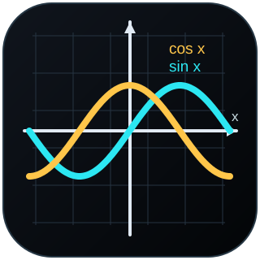
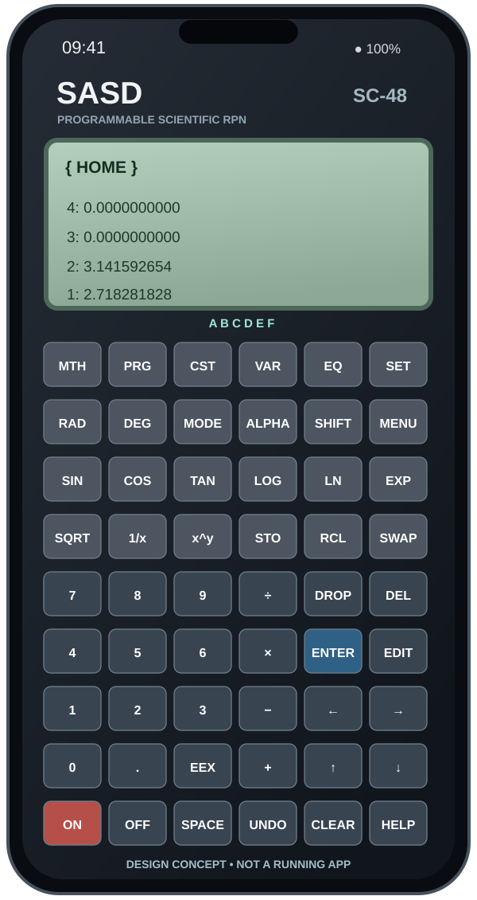
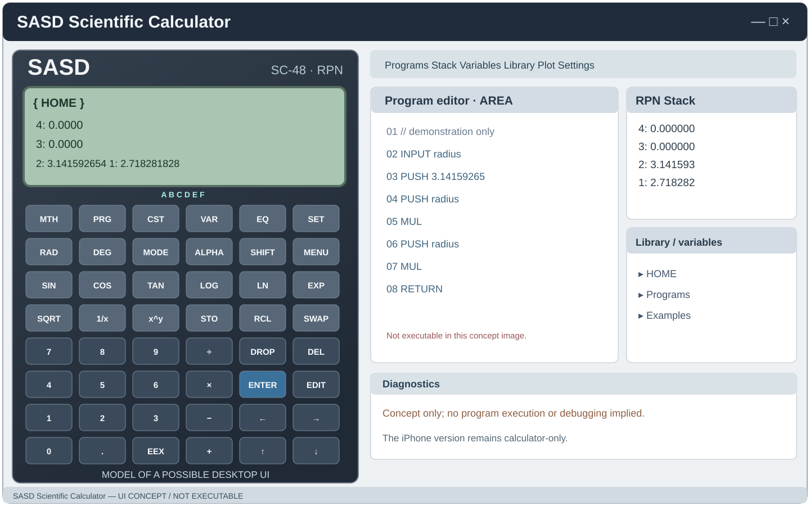

# SASD Scientific Calculator

[Deutsch](README.de.md) · [English](README.md) · **[Lastenheft (DE)](docs/LASTENHEFT.md)** · [Roadmap](ROADMAP.md) · [Architektur](docs/de/ARCHITEKTUR.md) · [Anforderungen](docs/de/PRODUKT.md)

<p align="center"></p>

**Ein klassischer, stackbasierter wissenschaftlicher Taschenrechner für moderne Geräte.**

> **Stand: frühe technische Grundlage, noch keine veröffentlichte App.** Ein kleiner, getesteter RPN-Rechenkern in C++20 mit Entwickler-CLI ist vorhanden. **Eine lauffähige iPhone-App, ein historischer Programminterpreter und eine Desktop-IDE existieren noch nicht.** Alle Abbildungen sind **generierte Designentwürfe**, keine Screenshots einer laufenden Software.

## Unser wichtigstes Ziel

Zuerst entwickeln wir einen **hochwertigen, zuverlässigen, vollständig offlinefähigen iPhone-Rechner mit klassischer UPN/RPN-Bedienung**. Er soll ohne Werbung und Abonnement auskommen, möglichst kostenlos angeboten werden und auch das **iPhone XS** berücksichtigen. Vollständige historische Maschinen- oder Programmkompatibilität darf Version 1.0 **nicht** blockieren.

Unsere Strategie lautet **„Strategie C mit konsequenter Priorität A“**: Langfristig planen wir wiederverwendbare Bibliotheken, mehrere eigenständige Anwendungen und historische Kompatibilität; kurzfristig bekommt der klassische Scientific Calculator Vorrang vor Plattformausbau und Zusatzprojekten. Ein Finanzrechner gehört in ein **separates Produkt und Repository**.

### iPhone: nur der Rechner im Hochformat

<p align="center"></p>

Das iPhone zeigt den **Taschenrechner selbst**, nicht zusätzlich Desktop-Editor, Seitenleisten oder Werbung. Der vollständige Tastenumfang, sinnvolle Shift-/Alpha-Ebenen, gut bedienbare Tasten, ein lesbares Display und eine **dezente anklickbare SASD-Kennzeichnung links oben** sind vorgesehen. Die tatsächliche Tastenbelegung wird **unabhängig** vom generierten Bild geprüft.

### Desktop: optionale Entwicklungsumgebung



Am PC dürfen neben dem Rechner ein Programmeditor, Stack-/Variablenansichten, Bibliotheken und Diagnosefunktionen stehen. Sie sind zusätzliche Oberflächen über einem UI-unabhängigen Kern und **keine Voraussetzung für das iPhone**.

## Ehrlicher Entwicklungsstand

| Bereich | Status |
| --- | --- |
| Produktstrategie, Architektur, Meilensteine, Kompatibilitätsstufen | **Dokumentiert** |
| Kleiner portabler C++20-Kern: Push, Dup, Swap, Drop, Clear, +, −, ×, ÷ | **Erste funktionierende Grundlage** |
| Entwickler-CLI und automatisierte Kern-Tests | **Erste funktionierende Grundlage** |
| Wissenschaftliche Funktionen, Register, Modi, dauerhafte Zustandswiederherstellung | **Geplant** |
| iPhone-App einschließlich App-Store-Veröffentlichung | **Geplant** |
| Historische Anwenderprogramme, Systemfunktionen und CPU-/OS-Emulation | **Spätere Meilensteine** |

Der aktuelle Entwicklerkern verwendet `double` und einen dynamischen Stack. Er ist **kein historischer Emulator**. Fehler dürfen vorhandene Stackwerte nicht beschädigen.

## Drei eigenständig veröffentlichbare wissenschaftliche Rechner

| Variante | Aufgabe | Priorität |
| --- | --- | --- |
| **Klassischer UPN/RPN-Rechner** | Alltagstauglicher iPhone-Rechner mit zuverlässiger Stack-Bedienung | **Erster Release M1–M2** |
| **Algebraischer Rechner (ALG)** | Eigene wissenschaftliche App mit `=`, Klammern und Operatorrangfolge | Geplant, parallel möglich; **kein V1-Blocker** |
| **Erweiterter RPL-Rechner** | Eigenständige historische Objekt-/Programmlaufzeit | Langfristige Ausbaulinie |

Alle drei verwenden nach Möglichkeit eine **gemeinsame mathematische Basis**, ohne ihre Eingabe-, Stack-, Zahlen- und Programmsemantik gleichzusetzen. Der ALG-Parser ist für die eigene App und eine spätere optionale algebraische Eingabe in historischen Rechnerprofilen vorgesehen. Scientific und Financial bleiben **getrennte Produkte und Repositories**.

### Die letzten Entwürfe in der README

Oben sind die beiden **aktuellen iPhone- und Desktop-Konzeptdarstellungen** sichtbar. Es handelt sich um **SVG-Neuzeichnungen** der zuletzt diskutierten Bildschirmkonzepte, nicht um pixelgenaue Kopien der Originaldateien `SASD RPN Calculator on iPhone.png` und `SASD RPN Calculator SC-48 Interface.png` und nicht um Fotos einer fertigen App. Die Original-PNGs liegen in der Projektbibliothek, **nicht im GitHub-Repository**. Details: [Bildherkunft](docs/images/README.md).

### Vertiefende Projektunterlagen

- **[Konsolidierte Anforderungen (DE)](docs/de/ANFORDERUNGEN.md)** und [Anforderungsmatrix (EN)](docs/en/REQUIREMENTS-MATRIX.md).
- [Mehrrechner-Architektur](docs/en/MULTI-APP-ARCHITECTURE.md), [ALG-Eingabe](docs/en/ALGEBRAIC-INPUT.md) und [gemeinsame Komponenten](docs/en/SHARED-COMPONENTS.md).
- Historische 41er-[Programmierung](docs/en/HISTORICAL-41.md) und 48er-[RPL-Systeme](docs/en/HISTORICAL-48.md), [Erweiterungsmodule](docs/en/MODULES.md).
- [V1-Abnahmekriterien](docs/en/RELEASE-V1.md), [Tests](docs/en/TEST-MATRIX.md), [Lernen/Hilfe](docs/en/LEARNING.md) und [offene Detailentscheidungen](docs/en/DECISION-QUESTIONS.md).


## Verbindliche Reihenfolge

| Meilenstein | Ziel |
| --- | --- |
| **M0** | Repository, Anforderungen, Architektur, reproduzierbare Builds, CI, erste Tests |
| **M1** | Getesteter, praxistauglicher klassischer UPN-/RPN-Rechenkern mit Basiswissenschaft und Registerfunktionen |
| **M2** | Ausgereifte iPhone-App und **App-Store-V1.0**: Bedienung, Persistenz, Offline, Tests, Rechtliches |
| **M3** | Historische Anwenderprogramme der getrennten 41er- und 48er-Familien |
| **M4** | Erweiterte systemnahe historische Kompatibilität |
| **M5** | Optionale Forschung zu Prozessor- und OS-Emulation; **kein** V1-Blocker |

Die Kompatibilitätsstufen **K1–K4** sind davon getrennt: K1 klassische Rechnerfunktionen, K2 Anwenderprogramme, K3 systemnahe Funktionen, K4 Maschinenkompatibilität. **Pro Release** wird nur die tatsächlich nachgewiesene Abdeckung dokumentiert. Siehe [Kompatibilitätsmatrix](docs/en/COMPATIBILITY.md).

## Technik und Grenzen

Geplant ist ein portabler **C++20/CMake-Rechenkern** mit automatisierten Tests und klar getrennten Benutzeroberflächen. Für iOS ist **SwiftUI** mit einer schmalen C-Schnittstelle zum Kern vorgesehen; Mindestversionen müssen am echten Zielgerät geprüft werden. Desktop, Android, iPad und weitere Plattformen folgen der iPhone-Priorität.

Die gemeinsame Mathematik kann später geeignete, **versionierte C++-Funktionen** des [SASD Math Toolkit](https://github.com/Robin-Goerlach/SASD-Math-Toolkit) verwenden. Eine noch nicht vorhandene Schnittstelle oder eine C#-Implementierung darf das erste iPhone-Release nicht blockieren. Ein Webserver, Cloudkonto und dauerhafte Internetverbindung sind für Rechenfunktionen nicht erforderlich.

## Den vorhandenen Entwicklerkern bauen

Voraussetzung: C++20 und CMake ab 3.20.

```sh
cmake -S . -B build -DCMAKE_BUILD_TYPE=Debug
cmake --build build --config Debug
ctest --test-dir build -C Debug --output-on-failure
./build/sasd-scientific-cli
```

Eingaben: `push 3`, `push 4`, `+`, `stack`, `quit`. Auf Windows liegt die ausführbare Datei je nach Generator gegebenenfalls unter `build/Debug/`. **Dies ist ein Entwicklungswerkzeug, keine fertige Endnutzer-App.**

## Dokumentation

[Produktanforderungen (DE)](docs/de/PRODUKT.md) · [Architektur (DE)](docs/de/ARCHITEKTUR.md) · [Roadmap](ROADMAP.md) · [Aufgaben](TASKS.md) · [Codex-Regeln](AGENTS.md) · [Tests (EN)](docs/en/TESTING.md) · [Releaseprüfung (EN)](docs/en/RELEASE-CHECKLIST.md) · [Entscheidungen (EN)](docs/en/DECISIONS.md).

Die englischen Fachunterlagen sind aktuell die ausführlichere technische Referenz. Bei Meinungsverschiedenheiten gelten die bestätigten Produktentscheidungen im Entscheidungsprotokoll, nicht die früheren generierten Screenshots.

## Produktidentität und Lizenz

SASD Scientific Calculator wird unabhängig entwickelt und unter eigener Kennzeichnung veröffentlicht. Fremde Marken und Produktbezeichnungen gehören nicht zur Außendarstellung. Sachliche Aussagen über später tatsächlich geprüfte Kompatibilität werden gesondert und rechtlich überprüft dokumentiert. Proprietäre Firmware, ROMs, Handbücher oder unlizenzierte historische Programme werden nicht übernommen.

**Lizenz:** [MIT](LICENSE) – die bereits im GitHub-Repository vorhandene Lizenz wird beibehalten. Sie räumt keine Rechte an fremden Marken und geschützten Materialien ein.

---

**Leitgedanke:** lieber früh ein verlässlicher Rechner als eine nie fertige perfekte historische Emulation.
