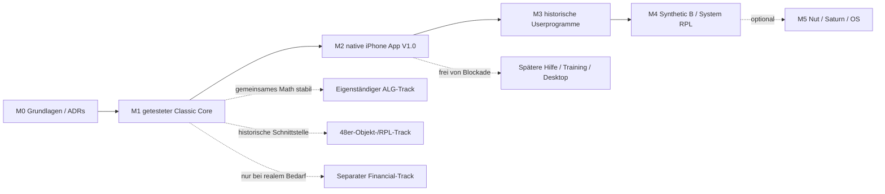

# Roadmap – SASD Scientific Calculator

**Dokument-ID:** SASD-SCI-ROADMAP-001  
**Version:** 2.0 – releaseorientierte, technische Umsetzungsroadmap  
**Stand:** 21.11.2026  
**Status:** **Projektplanung, keine Veröffentlichungstermine**  
**Normative Quellen:** [Lastenheft](docs/LASTENHEFT.md), [Pflichtenheft](docs/PFLICHTENHEFT.md)  
**Technisches Zielbild:** [Gesamtarchitektur](docs/ARCHITEKTUR.md)  
**Operative Aufgaben:** [TASKS.md](TASKS.md), [Freigabe-Checkliste](docs/en/RELEASE-CHECKLIST.md)

**English orientation:** This is the canonical Scientific Calculator roadmap. **Classic RPN iPhone first (M0–M2);** user programs and historical System RPL later (M3/M4); Nut/Saturn machine emulation optional (M5). A separate ALG app and advanced RPL app may progress on independent, **non-blocking** tracks. Financial is a separate product/repository. „Planned“ never means „implemented“.

> **Freigabeprinzip:** Wir veröffentlichen einen **ausgereiften, klassischen wissenschaftlichen UPN/RPN-Rechner**, sobald seine zugesagten Funktionen stabil, ausreichend getestet, lokal wiederherstellbar, offline und werbefrei auf dem iPhone funktionieren. Wir warten **nicht** auf vollständige historische FOCAL-/RPL-Programme, Systemfunktionen, originalgetreue ROMs oder CPU-/OS-Emulation.
>
> **Zwei unterschiedliche Achsen:** M0–M5 sind **Entwicklungs- und Freigabemeilensteine**. K1–K4 sind **historische Kompatibilitätsstufen**. Einzelne Synthetic-Stufen A/B/C bezeichnen wiederum eine andere, eigene Teilplanung.

---

## 1. Ausgangslage und Statuswörter

### 1.1 Repository-IST (kein Release)

| Vorhanden / überprüfbar | Nicht als vorhanden deklarieren |
| --- | --- |
| C++20/CMake-Basiskern `sasd_scientific_core` mit generischer dynamischer `RpnEngine` (`+−×÷`, einfache Stackaktionen) | noch keine freigegebene Vier-Ebenen-RPN-/ENTER-/LAST-X-Kompatibilität |
| Entwickler-CLI `apps/cli` und kleine CTest-Suite | noch keine native iPhone-App und keine App-Store-Veröffentlichung |
| GitHub Actions für den portablen Desktop-Kern (Linux/Windows/macOS; früher erfolgreiche Runs vorhanden) | kein Nachweis von iOS-/iPhone-XS-, historischer oder wissenschaftlicher Gesamtabdeckung |
| Lastenheft, Pflichtenheft, HP-41C-/HP-48GX-Funktionskataloge, technische Vorplanung | kein historischer 41-/48-Programminterpreter, kein ALG-Parser, kein vollständiger Snapshot-Codec |
| MIT-Lizenz; SVG-**Designkonzepte** für iPhone/Desktop/Icon | keine originalen HP-ROMs und keine realen App-Screenshots |

Die frühen Standard-C++-Tests dürfen weiterlaufen, auch wenn sie noch nicht das Classic-Produkt abbilden. Ein Dokument/Verzeichnis/Katalogeintrag ist **kein** Funktions-/Kompatibilitätsnachweis.

### 1.2 Statusvokabular

| Status | Aussage |
| --- | --- |
| **ERLEDIGT** | Lieferobjekt ist vorhanden, getestet; Beleg/Commit verfügbar |
| **IN ARBEIT** | Umsetzung begonnen; Qualitäts-/Freigabegate nicht abgeschlossen |
| **GEPLANT** | vorgesehen und in Backlog/Architektur erfasst, aber nicht nachweisbar fertig |
| **OPTIONAL** | eigenständiger späterer Entscheid, keine Lieferpflicht |
| **BLOCKIERT** | konkretes Problem mit verantwortlicher Folgeaktion und notwendiger Entscheidung |
| **OFFEN** | fachliche/technische Wahl vor dem jeweiligen Arbeitspaket zu treffen |

Nicht beschlossene **Kalenderdaten und Aufwandstage** werden nicht erfunden. Laufzeit- und Budgetschätzungen erfolgen erst nach überprüften Prototypen/ADRs.

---

## 2. Strategische Reihenfolge

**Das Diagramm zeigt Prioritäten, keine harte Sperre für technische Vorstudien.** RPL-Objektmodelle oder ALG können parallel untersucht werden, aber ohne dem M1→M2-Pfad Ressourcen/Releasequalität zu entziehen. Die Pfeile M3→M4 drücken wesentliche fachliche Abhängigkeiten aus (FOCAL vor Synthetic; User RPL vor System RPL), **nicht** eine zwingend vollständig sequenzielle Ausführung sämtlicher Spezialaufgaben.

### 2.1 Kritischer Pfad

`V1-Funktions- und Keymap-Vertrag` → `RPN-Stack-/ENTER-ADR` + `Numerik-ADR` → `Classic Core / Tests` → `Snapshot-/Restore-Vertrag` → `iOS ABI/SwiftUI` → `iPhone-XS-Gerätetests / Store-Gates` → **M2 App Store V1.0**.

Keines der späteren Ziele System RPL, Synthetic C, Saturn/Nut, Desktop-IDE, Financial, Advanced ALG oder originale ROM-Reproduktion darf unbeschlossen zu einem zusätzlichen V1-Gate werden.

---

## 3. M0 – Architekturfundament und entscheidungsfähige V1-Verträge

**Status: IN ARBEIT.** Einige Basisteile sind vorhanden, mehrere fachliche Schnittstellenentscheidungen **nicht**.

### 3.1 Ziel und Lieferobjekte

- Quellen-/Rechtebasis, C++20-/CMake-/CTest-/CI-Fundament und saubere Modul-/Dependency-Regeln verifizieren.
- Lastenheft → Pflichtenheft → [Architektur](docs/ARCHITEKTUR.md) → Arbeitspakete/Tests abgleichen.
- **Exakte V1-Keymap** inklusive Haupt-/Shift-/ALPHA-/Display-/Stack-/Registeroperationen; die generierten Screenshots sind **nicht** die Funktionsquelle.
- **ADR-V1-INPUT:** `ENTER`, Zifferneingabe, Stack Lift/Drop, LAST X, Y/X-Operanden, Clear/Undo, Register und Fehler als Zustandsübergänge.
- **ADR-V1-NUM:** Zahlentyp, interne/angezeigte Genauigkeit, Rundung, DEG/RAD, Format, Domain/Overflow/Underflow, Toleranzen.
- **ADR-V1-STATE:** Zustandsschema, atomarer Persistenzpfad, Wiederherstellung und Recovery.
- **ADR-V1-API/IOS:** Port-/C-ABI-/Lifetime-/Error-Regeln; verifiziertes iPhone-XS-/iOS-/Xcode-Ziel.
- **ADR-V1-FEATURES:** kleine, aber vollständige freigegebene wissenschaftliche Funktionsliste.

### 3.2 Abnahme M0

| Gate | Status bei Erstellung | Beleg zur Freigabe |
| --- | --- | --- |
| Repository/C++20/CMake/CTest und MIT-Lizenz | **Basiskern vorhanden** | reproduzierbarer Build und Lizenzdatei |
| CI der bisherigen Basistests | **vorhanden, frühere erfolgreiche Runs** | konkreter erfolgreicher Run; nicht iOS |
| Lasten-/Pflichtenheft und Architektur verlinkt | **Dokumentation wird konsolidiert** | versionsbezogene Review-/Linkprüfung |
| Tastatur + Enter/LastX/Stack-Goldens | **OFFEN** | verabschiedete Key- und Zustandsmatrix |
| Numerik/Genauigkeits-/Winkelvertrag | **OFFEN** | ADR mit Referenzvektoren |
| Snapshot-/Bridge-/iPhone-XS-Verträge | **OFFEN** | dokumentierte Eigentums-/Schema-/Toolchain-Spikes |
| V1-Featureliste und Abnahme-IDs | **OFFEN** | jeder Command mit Funktion/Fehler/Test-ID verknüpft |

**M0-DoD:** Unbekannte Werte sind als solche entschieden oder für das nachfolgende Arbeitspaket explizit gesperrt. M0 **fordert keine** komplette 41er-Byte-/48er-Nibble-/ROM-Emulation. Kleine Toolchain-/Core-Spikes dürfen zur **Klärung** eines ADR schon vorher stattfinden.

---

## 4. M1 – zuverlässiger Classic-UPN-/RPN-Rechenkern

**Status: IN ARBEIT, jedoch nur minimaler generischer Arithmetik-Kern implementiert.** Die eigentliche Classic-Vier-Ebenen-Zustandsmaschine ist **GEPLANT**.

### 4.1 Vertical Slice M1.1 – klassische Eingabe und vier Registerebenen

| Aufgabe | Abhängigkeit | Fertig, wenn |
| --- | --- | --- |
| fachliche `ClassicSession` und `CalculatorAction` | Keymap und State-ADR | Commands können headless ausgeführt werden |
| X/Y/Z/T, LAST X, Ziffern-/Exponent-Eingabepuffer | Input-ADR + NumericContext | vollständige Vorher-/Nachher-Goldens je Eingabeaktion |
| `ENTER`, Stack Lift/Drop, SWAP/Roll, `Y op X` | Stack-ADR | deterministische Regler-/Operanden-/Error-State-Suite |
| Clear-/Undo-/Fehlerrücksetzung | genaue freigegebene Wirkung | kein unkontrollierter Datenverlust/invalides State |
| Registerbank, `STO`/`RCL` und freigegebene Registerarithmetik | Numeric und Registerbelegung | Store/Recall/Bounds/Side-Effect-Tests |

**Technische Regel:** Nicht die vorhandene `std::vector<double>`-Engine künstlich auf vier Werte kürzen und „HP-41-konform“ nennen. Neue Session-/Stacksemantik explizit modellieren; alte Basistests erhalten.

### 4.2 Vertical Slice M1.2 – freigegebene wissenschaftliche Mathematik

- Basismathematik und Potenzen/Wurzeln; Trigonometrie inkl. Winkelmodi; Logarithmen/Exp, übliche wissenschaftliche Funktionen **gemäß freigegebener V1-Matrix**.
- Gemeinsame mathematische Operationen mit NumericContext, wohldefinierten Error Codes und fachlich getrennten Stack-/Command-Adaptern.
- Display-/Formatkontext unabhängig vom zugrundeliegenden Rechenwert; Grenzen und Toleranzen testen.
- Noch keine Pflicht zur vollen 41er-/48er-Befehlssammlung, zu komplexen Matrizen, Statistikpaketen, Plotting, Userprogrammen oder ALG.

### 4.3 Vertical Slice M1.3 – Zustand, Fehler und API

- Stabile Command-/Result-/ViewState-Abstraktion für CLI/iOS; Test gegen unzulässige Commands/Registers.
- Versionierte, validierte Snapshot-Serialisierung mit Recovery-Vertrag und Schema-Tests.
- Dokumentierte Fehlergruppen: Input/Stack/Register/DivisionByZero/Domain/Overflow/Type/Persist und Capability.
- C++20-Headers/Targets ohne SwiftUI-/Host-Dateisystem-Abhängigkeiten.

### 4.4 Abnahme M1

- [ ] V1-Keymap/State-ADR und Numerikvertrag beschlossen.
- [ ] Alle in V1 zugesagten Grundoperationen samt Tastensemantik und Registereffekten implementiert.
- [ ] Automatisierte Vorher-/Nachher-Stack-/Entry-/LAST-X-/Registertests; gemischte Bedienabläufe.
- [ ] Mathematische Referenztests inkl. DEG/RAD, nicht darstellbaren Ergebnissen und Fehlern.
- [ ] Snapshot-Roundtrip, Korruption, Schema-Migration und Wiederherstellungsfehler geprüft.
- [ ] Headless CLI/API zeigt dieselbe Domainlogik wie später iOS.
- [ ] Linux-/Windows-/macOS-Build und tatsächlich ausgeführte Tests dokumentiert.
- [ ] Ein präziser **K1-Teilausschnitt** dokumentiert; keine Behauptung kompletter historischer HP-41C-/48GX-Kompatibilität.

**Exit M1:** Der Rechnerkern ist zuverlässig nutzbar und testbar, aber noch **kein** iPhone-App-Store-Produkt.

---

## 5. M2 – iPhone-App / erster App-Store-Release V1.0

**Status: GEPLANT; native App noch nicht implementiert.** Wichtigste erste Auslieferung.

### 5.1 Vertical Slice M2.1 – Native Bridge und Minimal-UI

- SwiftUI-iPhone-Hochformat, schmale versionierte C-ABI zu C++20, eindeutige Session-Ownership/Thread-/Error-/UTF-8-Regeln.
- Rechner füllt die nutzbare Hochformatfläche. Ergebnis/Stack/Status, freigegebene V1-Tasten einschließlich Shift-/ALPHA-/ggf. Softmenüs sind erreichbar.
- **Keine** permanente Desktop-IDE, Webserver, fremde Account-Seite oder `=`-Eingabepflicht in der Classic-App.
- Vollständige Umsetzung der freigegebenen Keymap, keine ungetesteten Abkürzungen auf Grundlage von SVG-Designkonzepten.

### 5.2 Vertical Slice M2.2 – Persistenz, Offlinehilfe und Bedienqualität

- Über tatsächliche App-Lebenszyklusereignisse hinweg gültige Stack-/Register-/Mode-Zustandswiederherstellung; defekte Snapshots sicher behandeln.
- Kompakte **offline mitgelieferte** Erklärung von RPN/ENTER/Registern/Angle-/Fehlerfunktionen, mit genehmigtem DE/EN-Umfang.
- **SASD**-Markenkennzeichen **oben links**, dezent anklickbar auf die bestätigte offizielle SASD-Webseite; kein Werbebereich.
- Offline-Berechnung im Flugmodus, ohne Login, Werbung oder Abonnement; Preis möglichst kostenlos, endgültige Store-Entscheidung separat.
- Touch-Ergonomie, lesbare Zahlen, Safe Areas, VoiceOver, Dynamic Type, reproduzierbare Navigation/Fehlerbehebung.

### 5.3 Vertical Slice M2.3 – reale Geräte- und Storefreigabe

| Gate | Nachweis |
| --- | --- |
| Unterstützte iOS-Version und **iPhone XS** | Toolchain/Deployment-ADR; ausführliche **reale** Gerätetests |
| Rechnerqualität | alle `AC-V1-001…017` nach tatsächlich freigegebenem Umfang |
| Offline-/Datenschutz | Flugmodus, kein Ads-/Subscription-/Account-/Netzabhängigkeits-SDK, korrekte Privacy-Angaben |
| Persistenz | Suspend/Terminate/Upgrade, State-Integrität, Recovery |
| UI | komplette Tastenmatrix, kein verdeckter Inhalt, VoiceOver/Tapflächen |
| Rechte/Marke | eigene SASD-Marke, Lizenzen, keine ungeklärten ROM-/Handbuch-/Fremdbilder |
| App Store | Bundle-ID, Signatur, echte Build-Screenshots, Listing, Versions-/Kompatibilitätsmatrix |
| Releasekriterien | keine bekannten schwerwiegenden Rechen-/Crash-/Sicherheits-/Datenverlustfehler |

### 5.4 Was M2 **nicht** blockieren darf

- FOCAL-/41C-Anwenderprogramme, 48er-User RPL und vollständige historische K2.
- Synthetic 41 A/B, Byte Grabber C, System RPL, virtuelle historische ROMs.
- Nut-/Saturn-CPU-/Hardware-/OS-Simulation.
- vollständige Strict-Historical-Speicherabbilder/-Karten.
- Advantage Pac, Time Module, Statistics Pac.
- eigenständige ALG-App, ALG/RPN-Umschalten, Advanced RPL, Desktop-IDE, Financial, umfangreiche interaktive Lehrkurse.

**Exit M2:** Ein professioneller klassischer wissenschaftlicher RPN-Taschenrechner ist im freigegebenen Umfang app-store-fähig. Der tatsächliche **Veröffentlichungszeitpunkt** hängt zusätzlich von Store-/Signatur-/Reviewfreigaben ab. Keine erfundenen Veröffentlichungsdaten.

---

## 6. M3 – historische Anwenderprogramme: FOCAL und User RPL

**Status: GEPLANT; langfristig verbindliche, inkrementelle Ausbauphase.**

### 6.1 Serie 41 – normale historische Programme

- Modellkonforme 41er-Register-/Stack-/ALPHA-/Flag-/Statusoperationen, bei Bedarf verlustfreie 56-Bit-Rohrepräsentation.
- Byteorientierter Programmspeicher, FOCAL-Befehlsdecoder/VM, Programmsteuerung, Programminput/-output, Status/Fehler und Referenztests.
- Unterstützte Modellvarianten 41C/41CV und Programmaustauschformate erst nach `ADR-41-BYTECODE` und Quellen-/Rechteprüfung.

### 6.2 Serie 48 – User RPL

- 48er-Objektmodell (logische Objekte + historische Prolog-/Nibblecodec-Schnittstelle), Daten-/Return-Stack, Verzeichnisse/Variablen, Programmausführung.
- Unterschiedliche Typen für reell/komplex, Algebraobjekte, Listen, Matrizen/Vektoren, Zeichen, Programmschritte.
- Freigegebene Grundmodell-Befehle nach [eigenem Katalog](docs/de/HP-48GX-FUNKTIONSKATALOG.md) und zulässigen Referenztests, nicht als komplette behauptete Abdeckung.

### 6.3 M3-Gate

| Ergebnis | Abnahme |
| --- | --- |
| definierter 41er-FOCAL-Teilumfang | byte- und zustandsgenaue Referenzprogramme mit Modell-/Profilangabe |
| definierter 48er-User-RPL-Teilumfang | RPL-Objekt-/Stack-/Programm-Goldens, kompatible Typ-/Fehlerwirkungen |
| legale Daten-/Programmdateien | Import-/Export- und Snapshot-Roundtrips; keine Dritt-ROM-Übernahme |
| Regression | M1/M2-Kernfunktionen weiterhin fehlerfrei; keine gemeinsame 41-/48-Interpreterannahme |
| Kommunikation | **K2-Abdeckung** pro Release/Modell benannt; „teilweise“ von „vollständig“ trennen |

M3 ist **kein** harter Einzeltermin „alle historischen Programme sind vollständig“. Die Entwicklung kann **über mehrere voneinander unabhängige App-Updates** erfolgen.

---

## 7. M4 – System- und synthetische Programmkompatibilität, Module

**Status: GEPLANT; einzelne langfristig verbindliche Ziele, optionale Ergänzungen.**

### 7.1 Synthetic 41

| Stufe | Bindung | Umsetzung | Nachweis |
| --- | --- | --- | --- |
| **A** | Vorstufe für B, langfristig | ausgewählte synthetische Bytes/Kommandos im gleichen virtuellen 41er-Programmkern | Opcode-/Status-/Speichertests |
| **B** | **LANGFRISTIG VERBINDLICH** | ausgewählte historische synthetische Programme mit Zeiger-/Tastenzuweisungs-/Byte-/Registereffekten | Programme plus vollständige Referenzzustände, korrigierter Byte-Roundtrip |
| **C** | **OPTIONAL** | Byte Grabber/Byte-Hüpfer und spezielle Firmwareeffekte | separate Freigabe/Kosten-Nutzen-Analyse |

B **erzwingt keine** Nut-CPU-Emulation; C darf die erste iPhone-App nicht verzögern.

### 7.2 System RPL 48GX

- Nach User-RPL-Grundlagen ein **dokumentierter, testbarer Teilumfang** System-RPL-Primitive und -Programme als langfristige Verpflichtung.
- Historische RPL-Objekte, Daten-/Return-Stack, virtuelle ROM-/RAM-/Karten-/Lib-Profile und sichere `SYSEVAL`-/`LIBEVAL`-Auflösung.
- Historische Adressen **niemals** native Hostpointer; unbekannte ROM-/Library-Ziele kontrolliert als „nicht unterstützt“ melden.
- Änderungen an System-RPL-Objektcodec/Systemcall-Resolver müssen **User-RPL-Regression** bestehen.

### 7.3 Erweiterungsmodule und historische Profile

- Time Module und Statistics Pac als nachrangige 41er-Module, mit eigenen Zuständen und nachweisbarer Mathematik-/Befehlssemantik.
- Advantage-Pac-inspirierte Funktionsgruppen **optional** (Komplex/Matrizen/Vektor/Solver/Polynome/Integration/Differentialgleichungen/Zahlensysteme/Bitlogik/Statistik/Finanzgrundfunktionen), **ohne** doppelte math-Algorithmen und ohne originale ROM-/XROM-Reproduktion.
- Historical Core + Modern Input und Strict Historical (opt-in), RAM-/Karten-/ROM-/Modulkonfiguration und historisch sichtbare Ressourcengrenzen nach referenziertem Profil.
- 48GX-Grundkonfiguration 128 KiB RAM plus ggf. Erweiterungskarten **nicht** als allgemeine moderne iPhone-Speichergrenze.

### 7.4 M4-Gate

**K3-Nachweismatrix** nach Befehl, Programm, Byte-/Objektzustand, Modell/ROM-/Modulprofil, virtueller Memory-Wirkung, Referenzprovenienz und Sicherheitsstatus. Fehlende Bausteine werden offen genannt, keine pauschale vollständige System-RPL- oder Synthetic-Kompatibilitätsbehauptung.

---

## 8. M5 – optionale Nut-/Saturn-/OS-Forschung

**Status: OPTIONAL; kein Implementierungsauftrag.**

- Nut-Prozessor/HP-41-Hardware und Saturn-Prozessor/HP-48-Hardware sind **unterschiedliche** Rechnerarchitekturen. Keine gemeinsame triviale CPU-Klasse erzwingen.
- Vor Start: dokumentierter Nutzen gegenüber einer bereits funktionierenden 41-/48-Runtime, Referenzprogramm-/ROM-Rechtelage, Aufwand, Durchführbarkeit, Hardware-/Instruktionsmodell und Testbudget.
- Forschungs-Deliverable kann eine **Machbarkeitsstudie mit klarer Nichtumsetzungsentscheidung** sein.
- Ein eigenständiger optionaler Interpreter muss begrenzte, rechtmäßig bezogene Testmaschinenprogramme deterministisch ausführen und **hostseitig isoliert** sein.
- Historische Betriebssystem-/Firmware-Reproduktion ist ebenfalls **optional**; keine implizite Voraussetzung für System RPL oder V1.

**M5 bekommt niemals automatisch Vorrang vor M2**, auch wenn eine interessante technische Forschungsidee vorliegt.

---

## 9. Unabhängige Scientific-Entwicklungslinien

Diese Linien sind Teil der langfristigen Produktarchitektur, **aber kein zweiter widersprüchlicher M0–M5-Plan**. Sie erhalten eigene Version-/Test-/Release-Checkpoints und dürfen M1/M2 nicht blockieren.

| Track | Technischer Startpunkt | Erster sinnvoller Scope | Eigener Gate |
| --- | --- | --- | --- |
| **ALG Scientific App** | freigegebener Math-/Value-/Command-Vertrag | Lexer/Pratt/AST, `+−×÷^`, Klammern, Variablen/Functions, `Ans`, `=` | Parser-/Numerik-/Fehler-/UI-Tests, eigene App baubar |
| **ALG-Modus in historischen Apps** | ALG-Engine + konkreter 41-/48-Modelladapter | read-only/explicit result commit, kontrollierte Profile | historische Programme unverändert, Stack-/RPL-Objekt-Importtests |
| **Advanced RPL App** | 48er-Objekt-/User-RPL-Foundation | dynamischer Objektstack, User RPL/Verzeichnisse, sinnvolle UI | unabhängige App/Programmreferenzen |
| **Advanced Scientific Math** | stabiler NumericContext | Complex, Matrizen, Solver, Statistik, Integration/Einheiten | algorithmische Tests, Capability-gesteuerte Freigabe |
| **Offline Manual / Training** | funktionierende Commands/Metadaten | DE/EN-Handbuch, RPN↔ALG-Vergleich, Übungen und optional echte Traces | kein zweiter Mathe-Interpreter, Test mit realem Kern |
| **Desktop/iPad/Android** | bewährte Facade/Port | eigenständige Frontends, optional Editor/Inspektoren/Debugger | Plattform-/Geräte-Tests und eigene Release-Gates |
| **Financial** | tatsächlicher geteilter Bibliotheksbedarf | unabhängiges Finanzmodell und Produkttests im eigenen Repo | keine Scientific-Abhängigkeit zur Laufzeit oder Releasezeit |

### 9.1 Releaseunabhängigkeit

Die Classic-, ALG- und Advanced-RPL-App können **technisch** separat gebaut, versioniert und veröffentlicht werden; endgültige App-Store-Listing-/Namensstrategie bleibt eine spätere Produktentscheidung. Financial ist ausdrücklich **keine** Unter-App im Scientific-Repository.

---

## 10. Technische Arbeitspakete und Abhängigkeiten (WP-00 bis WP-16)

Die WP-Kennungen stammen aus [Pflichtenheft Kapitel 22](docs/PFLICHTENHEFT.md); **TASKS.md** ist das operative Backlog. Eine Zeile hier ist ein Lieferplan, kein GitHub-Issue- oder Implementierungsnachweis.

| WP | Phase/Track | Technische Aufgabe | Voraussetzung | Test-/Abnahmetyp | Priorität |
| --- | --- | --- | --- | --- | --- |
| **WP-00** | M0 | Ist-Kern, CI, Quellen-/Lizenz-/Architekturstand prüfen | vorhandenes Repo | CMake/CTest/Review | **P0** |
| **WP-01** | M0 | V1-Keymap/Stack-/Entry-/State-ADR | geprüfte Tastenquelle | Golden-State-Tabelle | **P0** |
| **WP-02** | M0 | Numerik-/Präzisions-/Format-/Fehler-ADR | numerische Referenzen | CORE-/NUM-Goldens | **P0** |
| **WP-03** | M1 | Classic-State-Machine mit X/Y/Z/T, LAST X, Register, Modi | WP-01/02 | vollständige RPN-State-Tests | **P0** |
| **WP-04** | M1 | freigegebene gemeinsame wissenschaftliche Mathematik | WP-02 | NUM/CORE/DOMAIN | **P0** |
| **WP-05** | M1/M2 | versionierte lokale Zustands-/Snapshot-/Recovery-Logik | WP-03 + State-ADR | STATE/Corruption/Migration | **P0** |
| **WP-06** | M2 | SwiftUI iPhone + Native Bridge | WP-03/04, API-/iOS-ADR | ABI/IOS-UX/XS | **P0** |
| **WP-07** | M2 | Offlinehilfe/SASD-Link/Store-/Privacy-/Legal-Gates | WP-03…06 | Release-/Gerätebeleg | **P0** |
| **WP-08** | ALG | separater ALG-Parser/Rechner-/App-Track | stabiler Math-Vertrag + ALG-ADR | ALG/CROSS | P2 |
| **WP-09** | M3 | 41er-FOCAL und historische Byte-/Register-VM | 41er-ADR, legale Fixtures | 41-FOCAL | P2 |
| **WP-10** | M3 | 48er-User-RPL und Objekt-/Nibble-VM | 48er-ADR, legale Fixtures | 48-USER | P2 |
| **WP-11** | M4 | Synthetic 41 A/B, C nur bei Entscheid | WP-09 + Belege | 41-SYN-A/B | P3 |
| **WP-12** | M4 | ausgewähltes 48er-System-RPL-/ROM-Subsystem | WP-10 + ROM-ADR | 48-SYS/SEC | P3 |
| **WP-13** | M4+ | Time/Statistics/Advantage und Speicher-/Kartenprofile | WP-09/10 + Math | MEM/EXT | P3/optional |
| **WP-14** | post-M2 | umfangreiche Hilfe/Training/Desktop-Panes | reale Commands/Apps | EDU/UX | P2/P3 |
| **WP-15** | M5 | Nut/Saturn/OS-Machbarkeitsforschung | eigener Beschluss | K4 falls begonnen | P4/optional |
| **WP-16** | Financial | Bibliotheks- oder Quellcodewiederverwendung | realer zweiter Verbraucher | getrennte Builds/Provenienz | separat |

**Prioritätsschlüssel:** P0 = kritischer Pfad zur klassischen iPhone-V1; P2 = nachrangige eigenständige Produktlinie; P3 = Spezialkompatibilität/Erweiterung; P4 = optionales Forschungsfeld. Eine kurzfristig schwere Fehlerkorrektur im gemeinsamen Kern überholt neue Features.

---

## 11. Exakte Dokumente, die vor Codearbeit fällig sind

Viele Grundlagen **existieren schon**. Es soll **keine** zweite große Roadmap, keine dritte Architekturbeschreibung und keine inhaltsgleiche neue Anforderungsmatrix entstehen.

| Reihenfolge | Dokument / Rolle | Bestehende Basis | Erforderliche Konkretisierung | Gate |
| --- | --- | --- | --- | --- |
| **1** | **V1-KEYMAP / Funktionsmatrix** | [KEYBOARD-UX.md](docs/en/KEYBOARD-UX.md) | jede Haupt-/Shift-/ALPHA-/Softmenüfunktion, V1-Ja/Nein, Command-ID, Fehler, Test-ID | WP-01/M1 |
| **2** | **ADR-V1-INPUT** | [DECISION-QUESTIONS.md](docs/en/DECISION-QUESTIONS.md), Pflichtenheft 6 | `ENTER`, LAST X, Stack Lift/Drop, Entry, Register, Clear/Undo als vollständige Zustandsübergänge | WP-03/M1 |
| **3** | **ADR-V1-NUM** | Pflichtenheft 7, [Requirements](docs/en/REQUIREMENTS-MATRIX.md) | Typ, Präzision, Rundung, Über-/Unterlauf, DEG/RAD, Display, Tests | WP-04/M1 |
| **4** | **ADR-V1-STATE** | Pflichtenheft 14 | versioniertes Snapshot-Schema, atomarer Save, Recovery und Migration | WP-05 |
| **5** | **ADR-V1-API und iOS-Kompatibilität** | [ARCHITEKTUR.md](docs/ARCHITEKTUR.md), [V1-Scope](docs/en/RELEASE-V1.md) | C ABI/Ownership/Threading, iPhone-XS-/Xcode-/iOS-Mindeststand, Store-/SASD-URL-Gate | WP-06/M2 |
| **6** | **V1-Test- und Freigabenachweis** | [Testmatrix](docs/en/TEST-MATRIX.md), [Release-Checkliste](docs/en/RELEASE-CHECKLIST.md) | reale Test-IDs/Geräte/Builds/Privacy/Legal/Signaturen | WP-07/M2 |
| später | ALG-Grammatik-/41er-Byte-/48er-Objekt-/System-/Strict-/Modul-ADRs | vorhandene Historik/ALG-Dokumentation | erst bei jeweiligem Track; keine M2-Sperre | ALG/M3/M4/M5 |

**Entscheidungsregel:** Nicht jedes Detail muss vor **jeder** Codezeile fertig sein. Kleine CI-/Toolchain-/Datenmodell-Spikes können ADRs empirisch vorbereiten. **Semantikrelevante Implementierung** wird erst begonnen/abgenommen, wenn der dafür maßgebliche Eingabe-/Numerik-/Zustandsvertrag verbindlich ist.

---

## 12. Offene Entscheidungen mit Fälligkeit

| Offener Punkt / Lastenheft-ID | Vor welchem Schritt? | Was passiert, wenn ungeklärt? |
| --- | --- | --- |
| `LH-OD-001/002` – Tasten/ENTER/Stack | WP-03 | kein korrekt spezifizierter Classic-Zustand |
| `LH-OD-003` – Zahlen und Präzision | WP-04 | nicht vergleichbare Referenztests / riskante Datenmodelle |
| `LH-OD-004` – Persistenz | WP-05 | spätere Upgrade-/Datenverlustrisiken |
| `LH-OD-005/006/007` – iPhone, SASD URL, Hilfe, Preis | WP-06/07 | M2-App-/Store-Gate nicht erfüllbar |
| `LH-OD-008/009` – ALG-Syntax und App-IDs | WP-08 bzw. eigener ALG-Release | kein freigegebener ALG-Parser/App-Release |
| `LH-OD-010/011` – historische 41/48-Datei-/Objektsemantik | WP-09/10 | kein korrektes K2-Programmformat |
| `LH-OD-012/013` – synthetische Programme/System-RPL-ROM | WP-11/12 | kein belegter K3-Umfang |
| `LH-OD-014/015` – Strict Memory, Module/XROM | WP-13 | keine sichere historische Profile-/Modulfreigabe |
| `LH-OD-016/017` – Pakete und Financial | WP-16 | kein kontrollierter Cross-Repo-Reuse |
| `LH-OD-018` – Nut/Saturn/OS | WP-15 | Forschung bleibt optional |
| `LH-OD-019` – Plattformen/Training | WP-14 | keine Zusatz-App-Freigabe |
| `LH-OD-020` – Historikkatalog-Vollständigkeit | vor katalogbezogener Kompatibilitätszusage | keine behauptete vollständige Funktionsabdeckung |

**Nicht offen:** iPhone-RPN-first, Scientific-/Financial-Trennung, kein V1-Blocker aus vollständiger historischer Programm-/CPU-/OS-Emulation.

---

## 13. Historische Kompatibilität nicht mit Lieferung verwechseln

| K-Stufe | Inhalt | Typische Phase | Wer entscheidet „bestanden“? |
| --- | --- | --- | --- |
| **K1** | belegter Umfang klassischer Tastatur-/Stack-/Register-/Mathe-/Zahlensemantik | M1/M2 in Teilumfang | konkrete Referenz- und Testmatrix pro App/Profil |
| **K2** | ausgewählte historische Anwenderprogramme (FOCAL/User RPL) | M3 | Modell-/Programm-/Zustandsbelege |
| **K3** | synthetische 41er-Programme / System RPL | M4 | Byte-/Objekt-/Stack-/virtuelle Systembelege |
| **K4** | Nut-/Saturn-Maschinen- und Hardware-/OS-Verhalten | M5 optional | separate reproduzierbare CPU-/OS-Testkorpora |

Die [HP-48GX-Quellen-/Befehlsmatrix](docs/de/HP-48GX-BEFEHLSABGLEICH-MATRIX.md) ist ein **nicht vollständig verifizierter Teilprüfstand**. Die vollständige historische Befehlsabnahme ist eine unabhängige Quellen-/Kompatibilitätsarbeit und kein iPhone-M2-Gate.

**Programmierkompatibilität ist kein boolescher Gesamtstatus.** Pro Release benennen: Modell/ROM/Modul, unterstützte Operationen, Quell-/Testbelege, Genauigkeits-/Error-/Stackzustand und Abweichungen.

Die beiden Historikkataloge sind wissenschaftliche Inventare; **auch ein vollständiger Katalog ist kein Softwareabnahmetest**.

---

## 14. Risiken und Gegenmaßnahmen

| Risiko | Kritischer Pfad? | Gegenmaßnahme / Entscheidungszeitpunkt |
| --- | --- | --- |
| falsch spezifiziertes ENTER/LAST X/Lift-/Stackverhalten | **ja** | WP-01/ADR vor WP-03; historische Tastenfolge-/State-Goldens |
| unklare interne Numerik und Anzeige-Genauigkeit | **ja** | WP-02; festes NumericContext-/Grenztestverfahren |
| iPhone XS nicht mit gewähltem SDK/Deployment unterstützt | **ja** | früher Apple-Toolchain-/Geräte-Spike; iOS-ADR |
| Snapshot-Datenkorruption bei Suspend/Upgrade | **ja** | versionierter, atomarer State und Recoverytests |
| Keymap aus SVG statt realer Referenz | **ja** | eigene autoritativ geprüfte Key-Inventory-Matrix |
| zu großer Shared-Math-Framework-Umbau | **ja** | kleine CMake-Targets, einfache C++20-Domain; später reale Wiederverwendung |
| unklare historische ROM-/Programmrechte | nicht für M2 | nur rechtmäßig zitierbare Referenztests, kein Original-ROM im Repository |
| „Alle Funktionen“ mit „Alle implementiert“ verwechselt | release-/rechtskritisch | Katalog ↔ Implementierung ↔ Test ↔ Release getrennt |
| Synthetische 41er-/System-RPL-Interna erzwingen Neuarchitektur | später | virtuelle 56-Bit-/Nibble-/ROM-Schnittstellen **jetzt berücksichtigen**, konkrete Interna erst M3/M4 |
| parallele ALG-/RPL-/Financial-Arbeiten blockieren V1 | **ja** | separate Arbeitspakete, API-Reviews, klarer P0-Pfad |
| vollständige Hardwareemulation wird stilles V1-Gate | **nein, untersagt** | M5 optional, expliziter neuer Beschluss notwendig |
| externe UI-Marke/Design verwechselt mit HP-Originalprodukt | Store-Gate | SASD-Marketing und Rechteprüfung, reale App-Screenshots |

---

## 15. Prüf- und Releaseprozess je Meilenstein

**Pro ausgeführtem Arbeitspaket:**

1. Zugeordnete **LH-/PH-Anforderungs-IDs** und Ziel-Release/Modell nennen.
2. Neue oder geänderte API-/State-/Numerik-/Codec-/Fehlerverträge prüfen.
3. Positive, negative und Grenztests dokumentieren; keine ungetestete Implementierung als fertig deklarieren.
4. Shared-Code-Regressionen aller **tatsächlich vorhandenen** betroffenen Apps/Engines ausführen.
5. Rechte/Provenienz bei historischen Daten, Fremdlibs und Bildern nachweisen.
6. Dokumente/README/Release-Matrix bei Funktionsänderungen aktualisieren.
7. Ergebnisstatus nur mit Git-Commit/CI-Run und ggf. realem Gerätetest auf **ERLEDIGT** setzen.

**Vor einer App-Store-Version zusätzlich:** Geräteliste, iOS-Minimum, echte Screenshots, Privacy-Labels, Signatur/Archive, Offline-/Werbe-/Abo-/Loginfreiheit, SASD-Link, freigegebene V1-Matrix, bekannte Bugs/Abweichungen, Reviewer/Datum dokumentieren.

---

## 16. Betriebliches Tasking und Codex-Parallelarbeit

- Backlog auf [TASKS.md](TASKS.md) und bei Bedarf GitHub-Issues abbilden. **Ein Arbeitspaket hat ein fachliches Eigentumsgebiet** (Classic State, Math, ABI, iOS UI, Persistenz, Docs/Tests, später ALG/41/48).
- Kleine, unabhängige C++-Module und Testfälle zuerst; **Main-Änderungen** sind bei Soloentwicklung zulässig, nachdem betroffene Tests geprüft wurden. Riskante parallele Arbeiten bevorzugt in getrennten Worktrees.
- Jeder Codex-Auftrag enthält **Abnahmekriterium, erlaubte Verzeichnisse/APIs, zu testende Befehle und ausdrücklich nicht zu implementierenden Scope**.
- Keine gleichzeitigen unkoordinierten Änderungen an ``NumericContext`, Session-ABI oder Snapshot-Schema. Öffentliche API-Veränderung mit Changelog/Architektur-Review behandeln.
- Blockaden sind mit konkreter offenen ADR/Device/Source-Rechte-Frage zu markieren; keine fehlende Historikvollständigkeit als V1-Blocker vortäuschen.

---

## 17. Keine künstlichen Zeitpläne oder Leistungsversprechen

Das Projekt hat **keine verbindlichen Kalenderliefertermine oder Entwicklerstunden** festgelegt. Ein realistischer Terminplan soll erst nach M0-Numerik-/Stack-ADR und einem integrierten Classic-/iOS-Vertikalschnitt anhand tatsächlicher Testergebnisse/Entwicklungsgeschwindigkeit entstehen.

Ebenso dürfen keine erfundenen Zielwerte für Millisekunden, RAM-Budget oder App-Größe eingeführt werden. Solche Metriken werden auf echten Zielgeräten gemessen und dokumentiert, bevor sie Qualitätsgrenzen werden.

**Qualitätsreihenfolge:** korrektes Ergebnis → kein Datenverlust → nutzbare Tastatur → iPhone-Stabilität → Releasekompatibilität → Performance-/UX-Optimierung → historische Ausbaubreite.

---

## 18. Dokumentenhierarchie und Änderungsregeln

1. **[Lastenheft](docs/LASTENHEFT.md):** verbindliche fachliche Anforderungen, inklusive 200 IDs.
2. **[Pflichtenheft](docs/PFLICHTENHEFT.md):** technischer Lösungsentwurf und vollständige 200-ID-Traceability.
3. **[Gesamtarchitektur](docs/ARCHITEKTUR.md):** Modulgrenzen, Daten-/Befehls-/ABI-/Speicher-/Sicherheitskonzept; verweist auf später zu beschließende ADRs.
4. **Dieses eine `ROADMAP.md`:** prioritärer M0–M5-Plan und app-spezifische Parallel-Tracks.
5. **[TASKS.md](TASKS.md):** operative Arbeitspakete, echte GitHub-Issues/Testbelege.
6. **ADRs:** jeweils konkrete offene Detailentscheidung mit Alternativen, Folgen, Referenzen, Testergebnis und Datum.
7. **[HP-41C](docs/de/HP-41C-FUNKTIONSKATALOG.md) / [HP 48GX](docs/de/HP-48GX-FUNKTIONSKATALOG.md):** historische Funktionsinventare, **kein** Implementierungsstand.
8. **[Release-Checkliste](docs/en/RELEASE-CHECKLIST.md):** die tatsächlich durchgeführten Abnahmeschritte, mit Belegen für jede ausgelieferte Version.

**Keine doppelte Roadmap:** ältere, stärker featureorientierte M0–M6-Vorschläge sind mit dem neuen **M0–M5-Fokus** konsolidiert. Die ALG-, Help-, Desktop- und wissenschaftlichen Parallel-Tracks bleiben ausdrücklich sichtbar, erhalten aber keinen zweiten widersprüchlichen Meilensteinplan.

---

## 19. Beschlussstand und nächster technischer Schritt

**Der unmittelbar nächste fällige fachliche Schritt ist die überprüfte V1-Tasten-/Funktionsmatrix**, anschließend die detaillierte RPN-Stack-Zustandstabelle und die numerische Policy. Ohne diese würden Codex und Entwickler zentrale Semantik raten müssen; das wäre gerade bei historischen Rechnern langfristig teuer.

Sobald diese drei Verträge vorliegen, kann die klassische C++20-Session klein und sauber implementiert und über eine native iPhone-Hülle früh ausprobiert werden. **Dokumente allein sind noch kein Fortschritt in K1**, aber eine sauber begrenzte Implementierung mit Tests ist einer umfangreichen ungetesteten Emulation vorzuziehen.

**Leitsatz:** Erst ein hervorragender wissenschaftlicher Taschenrechner für das iPhone – danach konsequent erweiterte historische Programmkompatibilität, ohne den funktionierenden Kern aufzubrechen.
