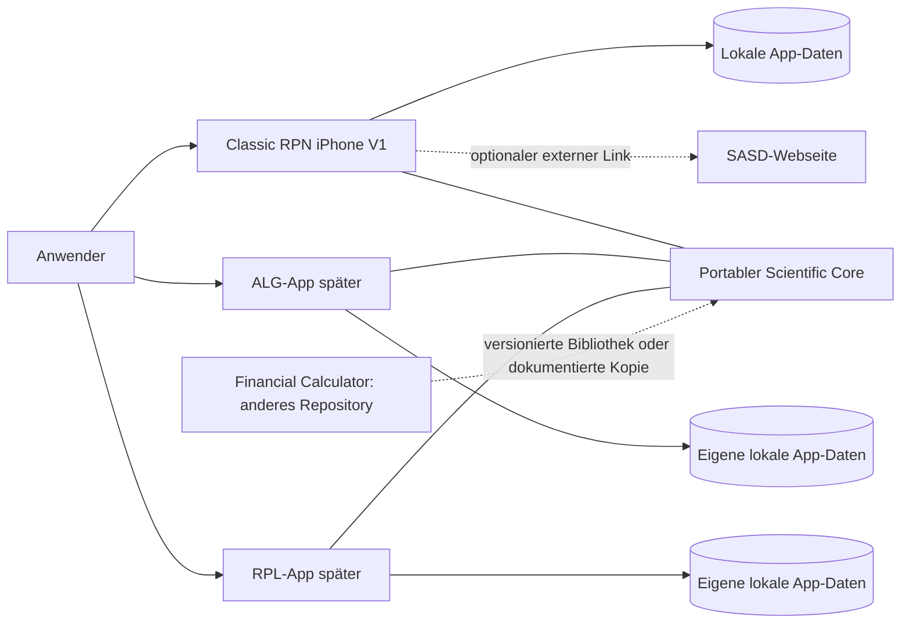
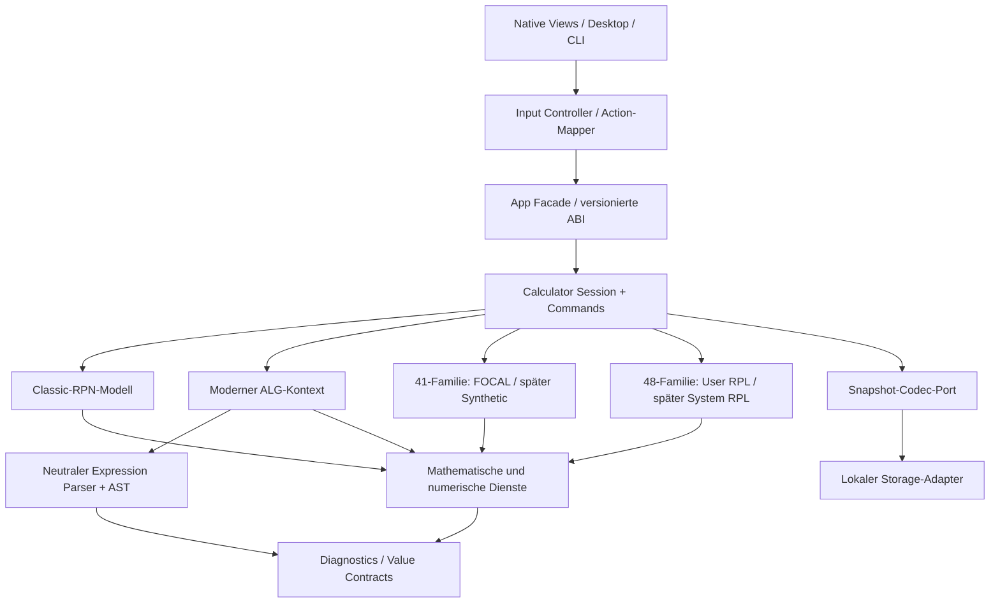
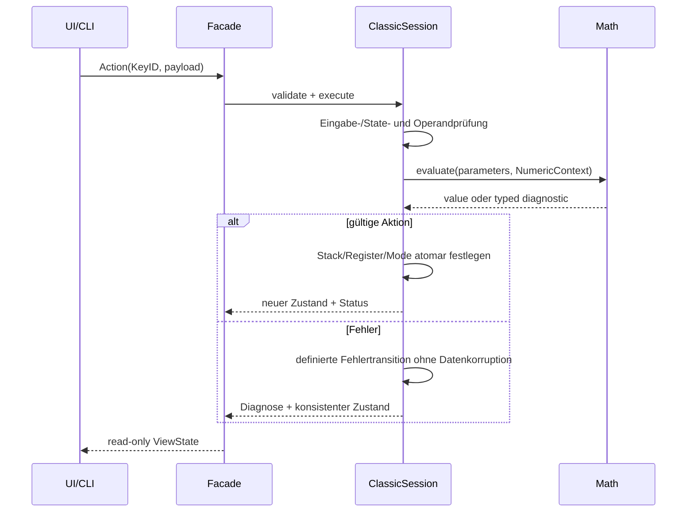
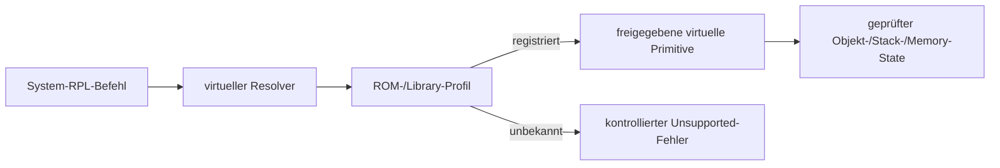
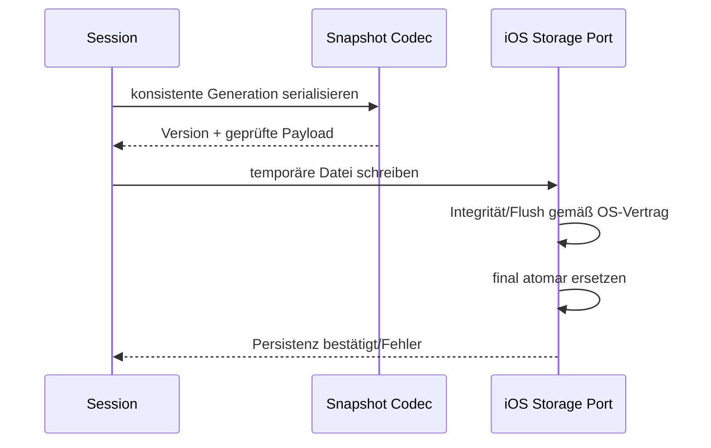

# SASD Scientific Calculator – Gesamtarchitektur

**Dokument-ID:** SASD-SCI-ARCH-001  
**Fassung:** 1.0 – Architekturentwurf zur Umsetzung des Pflichtenhefts  
**Stand:** 21.11.2026  
**Status:** **Zur fachlich-technischen Freigabe; keine Behauptung einer fertigen Implementierung**  
**Geltungsbereich:** alle wissenschaftlichen SASD-Rechner-Anwendungen dieses Monorepositories  
**Normative Quellen:** [Lastenheft](LASTENHEFT.md), [Pflichtenheft](PFLICHTENHEFT.md), [Entscheidungsregister](en/DECISIONS.md), [V1-Abnahmekriterien](en/RELEASE-V1.md)  
**Umsetzungsplanung:** [ROADMAP.md](../ROADMAP.md), [TASKS.md](../TASKS.md)

> **Architekturziel:** Ein verlässlicher, eigenständiger **klassischer UPN/RPN-Rechner für das iPhone zuerst**, während die Codebasis spätere ALG-, HP-41C-/CV- und HP-48GX-/RPL-Varianten sauber aufnehmen kann. Gemeinsame mathematische Algorithmen ja; künstlich vereinheitlichte historische Stack-, Programm-, Speicher- und Zahlenmodelle nein.
>
> **Abgrenzung:** Dies ist die strukturierte technische **Soll-Architektur**. Bezeichnungen, Verzeichnisse, API-Beispiele und Datenformate unter „Entwurf“ sind nicht automatisch bereits genehmigte Detail-ADRs. Nicht vorhandene Software wird nicht als implementiert bezeichnet. Die historische Vollkompatibilität ist **kein** Release-Gate der klassischen iPhone-V1.0.

---

## 1. Entscheidungsgrundlagen und überprüfter IST-Stand

### 1.1 Beschlüsse, die diese Architektur nicht verändern darf

1. **Strategie C mit konsequenter Priorität A:** langfristig eine erweiterbare Rechnerplattform, kurzfristig ein hervorragender klassischer wissenschaftlicher UPN-Rechner. Die erste App wird nicht durch historische Gesamtemulation aufgehalten.
2. **Eine Scientific-Produktfamilie in diesem Monorepo**, mit unabhängig baubaren/lieferbaren Classic-RPN-, eigenständiger ALG- und fortgeschrittener RPL-App. ALG und RPL sind **kein** M2-Blocker.
3. **Financial ist ein anderes Produkt** mit separatem vorgesehenem Repository, Produkt-/Daten-/UI-/Versions- und Release-Lebenszyklus; Wiederverwendung nur mit stabilen Bibliotheken oder dokumentiertem Quellcodekopieren.
4. **Historische Programmiersprachen bleiben selbständig:** normale 41er-FOCAL-Anwenderprogramme und 48er-User-RPL-Programme (M3), synthetische 41er-Programmierung **bis Stufe B langfristig verbindlich**, 48er-System-RPL in einem **definierten, referenzgeprüften Teilumfang langfristig verbindlich** (M4); Byte Grabber/Synthetic C und Nut-/Saturn-CPU-/OS-Nachbildung **optional** (M5).
5. **Funktionale Kataloge sind getrennt** von tatsächlich implementierten Funktionen: [HP-41C](de/HP-41C-FUNKTIONSKATALOG.md), [HP 48GX](de/HP-48GX-FUNKTIONSKATALOG.md). Erweiterungsmodule/ROMs besitzen eigene fachliche Abdeckung.
6. **Keine unzulässige ROM-, Marken-, Handbuch- oder Programmübernahme**; eigenständige SASD-Implementierung, bestehende MIT-Repository-Lizenz beachten.

### 1.2 Vorhanden versus geplant

| Bereich | IST (aktueller Repository-Prüfstand) | SOLL / erster Schritt |
| --- | --- | --- |
| Portable Core | C++20 / CMake, `sasd_scientific_core` mit `RpnEngine` und dynamischem `std::vector<double>` | gesonderte Classic-RPN-Vier-Ebenen-Zustandsmaschine mit spezifizierter Eingabe |
| Mathematische Operationen | Push, Duplicate, Swap, Drop, Clear, `+ − × ÷`, einfache Fehler | vollständig freigegebene M1-Basiswissenschaft inkl. Register, Modi und numerischem Vertrag |
| Tests/CI | einfacher CTest-Kern; GitHub-Action für Linux, Windows, macOS | vollständige State-Goldens, FFI/Restore/UI-Tests; spätere historische Suites |
| iOS | **nicht implementiert** | native iPhone-App, vorgeschlagen SwiftUI + definierte C-ABI |
| ALG | **nicht implementiert** | eigenständiger Rechnerkontext, Lexer/Parser/AST/Evaluator |
| HP-41 / HP-48 Programme | **nicht implementiert** | getrennte Historikmodule in späteren Meilensteinen |
| Persistenz | **nicht implementiert** | versionierte, validierte und atomar gespeicherte Session-Snapshots |
| Designs | SVG-**Konzeptzeichnungen** in `docs/images/` | echte iOS-Ansicht und spätere echte App-Store-Screenshots |
| Financial | kein Scientific-Untermodul; eigenes Produkt geplant | nur später bedarfsgetriebene Bibliothekswiederverwendung |

**Migrationsempfehlung:** Die vorhandene `RpnEngine` zunächst nicht unter gleichem Namen zum „HP-41-Emulator“ erklären. Behalte bestehende Tests und API als Prototyp/Kompatibilitätsschicht, führe einen benannten, explizit fachlichen **ClassicCalculator**-Zustand ein und migriere Anwendungen kontrolliert. Altverhalten wird erst nach Referenz-/ADR-Vergleich entfernt oder umbenannt.

### 1.3 Architekturqualitäten

Prioritäten (absteigend): **Rechenkorrektheit und Datenintegrität**, deterministische klassische Bedienung, zuverlässiger Offline-Betrieb, ergonomische iPhone-Bedienung, Testbarkeit, langfristige historische Erweiterbarkeit, Portabilität, Wiederverwendbarkeit. Historische Authentizität gilt nur im **explizit deklarierten** Profil/Umfang und darf Host-Sicherheit nicht kompromittieren.

---

## 2. Systemkontext und Grenzen



- **Im System:** Scientific-Quellcode, App-Adapter, Calculator-Sessions, Mathematik, Historik-Engines, Tests und offline bereitgestellte Hilfe.
- **Außerhalb:** App Store, Gerätesysteme/Apple-Toolchain, offizielle SASD-Webseite, mögliche spätere Financial-Anwendung und Historik-Referenzquellen. Eine Netzwerkverbindung wird **nie** zur Berechnung gebraucht.
- **Trust Boundary:** Tasteneingabe ist weniger riskant als fremde Zustands-/Programmdateien; alle Import-, Parser-, Snapshot- und virtuellen Systemaufrufgrenzen validieren ihre Daten.
- **App-Identität:** Eine gemeinsame Codebasis impliziert **keine** gemeinsam installierten Apps, kein geteiltes Benutzerkonto, keine gemeinsame notwendige Datenbank und keine synchrone Veröffentlichung.

---

## 3. Architekturansatz, Ebenen und Abhängigkeitsregel

**Stil:** Schlanker modularer Monolith für den portablen Kern, *Ports-and-Adapters* an Plattform-/Persistenzgrenzen und **klar getrennte Calculator-Bounded-Contexts**. Bewusst kein Web-/Microservice-/Plugin-Framework und kein generischer Emulator als Basisschicht.



Die Darstellung ist **logisch**. Die erste App muss nicht sämtliche genannten Engine-Knoten bauen oder initialisieren. In M1/M2 kann die ausführbare Abhängigkeitskette **UI → Bridge → Classic Session → Math → Persistence** genügen.

### 3.1 Strikte Richtung

- **UI kennt Anwendungsaktionen und View-State**, aber keine numerischen Implementierungsdetails.
- **Session orchestriert** Eingabezustand, validierte Kommandos, Modellwahl, Kompatibilitätsfähigkeiten und konsistente State-Commits.
- **Calculator-Engine besitzt allein** Stack-/Objekt-/Register-/Programmzustand und die historischen Nebenwirkungen.
- **Mathematik liefert pure Dienste** mit explizitem Zahlen-/Fehlerkontext, niemals native UI-/Host-Dateizugriffe.
- **Codec/Storage implementieren Ports**, nicht Taschenrechnerarithmetik.
- **Historische 41/48-Module importieren einander nicht**; gemeinsame Quellcode-/Testteile liegen in geeigneten kleinen Bibliotheken.

### 3.2 Vermiedene Alternativen

| Alternative | Warum verworfen bzw. verschoben |
| --- | --- |
| Ein universeller Stack-/Interpreterkern für 41, 48, ALG und Financial | inkompatible vierstufige/objektbasierte Programme, unklare Speicher- und Fehlersemantik |
| Voller Nut-/Saturn-CPU-/ROM-Emulator vor V1 | großer Aufwand, unklarer Nutzen, rechtliche ROM-Fragen, verletzt Release-First-Beschluss |
| Alle mathematischen Funktionen je App separat programmieren | Duplikate und numerische Divergenz; stattdessen wiederverwendbare **Algorithmen**, Modelladapter |
| SwiftUI rechnet selbst in Button-Handlern | nicht getestet, nicht plattformneutral, divergierende Kernsemantik |
| Sofort alles in externe gemeinsame SASD-Framework-Repositories auslagern | vorzeitige API-/Releasekomplexität; erst bei zweitem echten Verbraucher |
| Persistenz als ungeprüfter Dump von C++-Objektspeicher | ABI-/Schema-/Endianness-Probleme, Korruptionsrisiko |
| Historische virtuelle Adressen als native Zeiger verwenden | nicht sicher, plattformabhängig, sachlich falsch |
| ALG als Ersatz für gespeicherte historische Programme | andere Sprache und Ausführungssemantik, beschädigt Kompatibilitätsziel |

---

## 4. Modulverträge und Domänenverantwortung

| Modul / geplanter CMake-Target | Verantwortlich für | Öffentliche Abhängigkeiten | Darf **nicht** |
| --- | --- | --- | --- |
| `SASD::ScientificMath` (später) | elementare und erweiterte numerische Algorithmen | Value-/NumericContext-Verträge | UI, Stack Lift, Programme besitzen |
| `SASD::Numeric` (später) | Zahlendarstellungen, explizite Konversionen, Fehler/Präzision | C++20, überprüfte Adapter | Historik durch `double` erzwingen |
| `SASD::ClassicRpn` (M1) | Eingabe, X/Y/Z/T, LAST X, Register, Modi, Transaktionen | Math + Numeric | 48-RPL-Objekte importieren |
| `SASD::Expression` (später) | Unicode-Normalisierung, Lexer, Pratt/AST, Parserdiagnose | neutrale Value-/Diagnostics-Typen | historische FOCAL/System-RPL-Befehle ausführen |
| `SASD::Algebraic` (später) | ALG-Session: Ans/Variablen/Verlauf/Commit | Expression + Math | erfordert keinen historischen Kern |
| `SASD::Series41` (M3+) | historische 56-Bit-Register, Byteprogramm-VM, FOCAL, Synthetic | Math + virtuelle Speicherports | von Series48 abhängen |
| `SASD::Series48` (M3+) | RPL-Objekte, Daten-/Return-Stack, ROM-Profil, Systemresolver | Math + RPL-Codec | native ROM-Zeiger aufrufen |
| `SASD::CalculatorFacade` (M1/M2) | Commands, Capability-Check, Session-Lifecycle | freigegebene Calculator-APIs | eigene Mathematik implementieren |
| `SASD::NativeBridge` (M2) | ABI, Ownership, Threading, UTF-8, Error Transport | Facade | C++-Exceptions/STL über C exportieren |
| `SASD::Snapshot` (M1/M2) | validierte Serialisierung, Schema/Migration | fachliche Snapshot-Schnittstelle | Daten verändern, nur um sie laden zu können |
| `SASD::OfflineHelp` (später) | DE/EN-Hilfe, Command-Metadaten, Lernbeispiele | freigegebene Funktions-/Command-Kataloge | zweiten Rechenkern entwickeln |
| `SASD::ModuleAdapters` (M4+) | Modell-/Version-/ROM-spezifische Befehlsadapter | historischer Kern + math | Original-XROM-Binaries implizieren |

**Richtlinie:** Eine mathematische Funktion hat eine fachliche Function-ID. Eine historische Taste oder Opcode hat **eine andere Command-ID** mit expliziten Stack-, Rundungs- und Fehlerwirkungen. Command-IDs werden nicht aus frei bearbeitbaren Hilfetexten abgeleitet.

---

## 5. Zustandsmodell des Classic-RPN-Rechners

### 5.1 Expliziter, nicht UI-abhängiger Zustand

**Entwurf (Feldnamen illustrativ, keine vorab genehmigten C++-Typen):**

```text
ClassicSessionState
  model_id / capability_set / numeric_policy_id / state_version
  stack: { X, Y, Z, T }
  last_x
  entry_buffer: { sign, mantissa_digits, decimal_marker, exponent, edit_status }
  stack_transition_mode: { lift_enabled, entry_state, enter_state }
  registers: { addressing_policy, numeric_contents, state }
  modes: { angle_mode, display_format, precision, flags }
  diagnostic: { stable_error_id, ... }
  optional presentation_input_mode: { shift, alpha, soft_menu }  [ownership via ADR]
```

**Wichtige Abgrenzungen:** Ein vierstufiger Stack ist **kein** `std::stack<double>` mit Maximalgröße vier. `ENTER`, Stack Lift, binäre Operationen mit `Y op X`, T-Replikation/Drop, `LAST X`, Zifferneingabe, Registerarithmetik und Fehlerrückstellung bilden eine **Zustandsmaschine**. Die exakte historische Semantik wird *vor* dem ersten entsprechenden Code im **ADR-V1-INPUT** anhand freigegebener Tastenfolge-/Zustandstabellen festgelegt.

### 5.2 Kommandotransaktion



Die **moderne V1-Fehlerregel** ist „validieren, berechnen, dann vollständiger Commit“. Das ist **keine** pauschale Behauptung, historische FOCAL-/RPL-Programme seien immer atomar: Deren Sequenzen können eigene, separat referenzgeprüfte Zustandseffekte besitzen.

### 5.3 Sichtbare und interne Daten

- **Numerischer Wert** ≠ **Eintragspuffer** ≠ **Anzeigeform**: FIX/SCI/ENG bzw. andere Moduswechsel formatieren die Anzeige, runden aber den gespeicherten Wert nicht stillschweigend.
- Angezeigte X/Y/Z/T-Werte und Register-/Shift-Status werden aus fachlichem Zustand abgeleitet, nicht in Swift getrennt berechnet.
- Invalides Eingabe-/Exponententoken darf keine undefinierte Zahl in den dauerhaften Zustand schieben.
- Für jedes Kommando prüft ein Golden Test **Vorher-/Nachherzustand aller betroffenen Ebenen**, nicht nur die X-Zahl.
- Nicht unterstützte Tastenfunktionen dürfen nicht als aktiv und verfügbar erscheinen.

### 5.4 Benannte Vorbereitungsartefakte

`ADR-V1-INPUT` / `LH-OD-001`, `LH-OD-002`: endgültige V1-Haupt-/Shift-/ALPHA-Tastenmatrix und State-Transition-Tabelle. Freizugeben **vor** einer konkreten Classic-Engine-Implementierung; keine erdachten historisch exakten Füll-/Last-X-Regeln in diesem Architekturpapier.

---

## 6. Mathematischer Core, NumericContext und Genauigkeit

### 6.1 Mathematische Wiederverwendung

Der gemeinsame mathematische Kern unterstützt zuerst `+−×÷` und den freigegebenen wissenschaftlichen V1-Katalog (z. B. Wurzel/Potenz/Log/Exp/Trigonometrie/Winkelmodi), später komplexe Zahlen, Vektoren, reelle/komplexe Matrizen, Statistik/Regression, Gleichungslöser, Integration, Differentialgleichungen, Zahlensysteme/Bitoperationen und Einheiten. Ein „Funktionsname“ ist keine Releasezusage; **konkrete V1-Funktionsmatrix entscheidet**, historische Detailinventare sind separate Kataloge.

**Pflicht:** Gemeinsame fachliche Berechnung nicht unnötig doppelt entwickeln. **Ausnahme zulässig:** technisch begründete, belegte unterschiedliche Genauigkeits-/Algorithmenimplementierung für historische Zahlentypen oder Domainanforderungen.

### 6.2 Typen und numerischer Vertrag

**Verbindliche Entscheidung noch ausstehend – ADR-V1-NUM / LH-OD-003.** Sie muss festlegen:

| Dimension | Technisches Entscheidungsfeld | Regression |
| --- | --- | --- |
| Zahlentyp | binary64 `double`, Dezimaltyp/Mehrpräzision oder gestaffelte Backends | exakte/approximierte Werte, Sonderfälle |
| Rechenfehler | Rundung, Über-/Unterlauf, ±0, `NaN`/`Inf`, Domain/Division durch null | Grenz-/Fehlertests |
| Anzeige | FIX/SCI/ENG, Stellenzahl, Exponentenformat, lokalisierte Dezimaldarstellung | Anzeigen ändern gespeicherten Wert nicht |
| Winkel | DEG/RAD, ggf. GRAD | `sin(30)` im Gradmodus mit Toleranz ≈ 0,5 |
| Konversion | Value→historisches Register/RPL-Objekt | Verlust/Fehler sichtbar, keine stillen Truncations |
| Reproduzierbarkeit | Unterschiede von Standardbibliotheken/Plattformen | schriftlich festgelegte Fehlertoleranzen |

**Keine voreilige Entscheidung:** Weder soll die aktuelle binary64-Prototypwahl als endgültiges Genauigkeitsversprechen dienen noch ein schwergewichtiges Mehrpräzisionsframework V1 vorzeitig verzögern. Ein kleines, austauschbares `NumericPolicy`-/`NumericContext`-Konzept ist ausreichend, solange seine Definition keine unbewiesene bitgenaue Plattformgleichheit behauptet.

### 6.3 Metadaten und Befehlsfähigkeit

Ein **FunctionCatalog** beschreibt rein mathematische Signatur, zulässige Typen, Angle-/Precision-Kontext, Diagnose, Hilfe-ID und Testreferenz. Ein getrenntes **CommandCatalog** für Classic/41/48/ALG beschreibt Tastenzugriff, Stackeffekt, Opcode-/Modulzuordnung und Capability. Ein Katalogeintrag ist erst freigegeben, wenn Implementation + Tests vorhanden sind.

---

## 7. Port-, ABI- und Plattformarchitektur

### 7.1 Vorgeschlagene native Grenze

```text
SwiftUI
  -> InputController / ViewModel (Swift)
     -> C ABI mit opaque handle, klaren Datentypen und Versionen
        -> C++ Facade / CalculatorSession
           -> Classic Model / Math / Snapshot-Port
```

Die C-Schnittstelle ist ein **bewusster Vorschlag** gegenüber direktem Swift/C++-Interop, weil sie ABI-/Ownership-/Fehlergrenzen sichtbar macht und zusätzliche Plattformen erleichtert. Ein schmaler, implementierter Spike mit realem iPhone-XS-/Xcode-Ziel muss dies bestätigen. Kein voreiliges festes Swift-/C++-Bindungsframework als Produktvoraussetzung.

### 7.2 Schnittstellenvertragsentwurf

| Port | Operationen (konzeptuell) | Fehler-/Ownership-Regel |
| --- | --- | --- |
| Session-Lifecycle | `create(profile)`, `destroy(handle)`, `reset` | gültige Handle-ID/Version, kein Double Free |
| Command | `execute(handle, command, args)` | keine C++-Exception über ABI, typed status |
| View | `read_view(handle)` | kopierte oder dokumentiert geliehene View-Daten; konsistente Generation |
| Snapshot | `encode_state(handle)`, `restore_state(data)` | Länge/Version/Checks, Fehler ohne Teilmutation |
| Capabilities | `list_supported_commands(profile)` | echte Freigaben, keine geplant-als-aktiv Markierung |
| Diagnostics | `read_error(code, locale)` | stabile IDs, sichere UTF-8-Konversion |

Das ist **Pseudokontrakt**, kein bereits existierender Header und keine bindende konkrete Signatur. Das später zu entscheidende ABI-ADR spezifiziert C-Typen, Längen, Ownership, Aufrufthread, Reentranz, Async-Verhalten, Strings/Arrays und Versionsverhandlungen.

### 7.3 Lebenszyklus und Threading

- Die **Session hat einen klaren Eigentümer** und einen serialisierten Mutationspfad; UI-Werte sind unveränderliche Momentaufnahmen.
- Vorschlag für V1: Berechnungs-/State-Aktionen entlang einer kontrollierten Session-Queue; SwiftUI rendert auf Main Actor. Persistenz darf keine konkurrierenden Snapshots rückwärts „gewinnen“ lassen.
- Hintergrund/Suspend, App-Abbruch und Neustart werden über dokumentierte Persistenz-/Restore-Ports abgebildet.
- Die UI benötigt keinen permanenten Webserver und keine Internetverbindung. Der SASD-Link links oben öffnet **nur** bei aktiver Benutzerinteraktion einen externen Browser.
- Keine SDK-/Gerätekompatibilitätszusage ohne physischen Test; iPhone XS muss im vom Entwickler gewählten Xcode-/Deployment-Setup überprüft werden.

---

## 8. Persistenz, lokale Daten und Versionierung

### 8.1 Unterschiedliche Artefakte

1. **Calculator-Snapshot:** vollständiger relevanter Sitzungszustand, Modell-, Profil- und NumericPolicy-ID, Schema, Integrität.
2. **Programmdatei:** historisches 41er-Byteprogramm oder 48er-RPL-Objekt; nicht identisch mit einem gesamten Snapshot.
3. **Rechnerbibliothek/ROM-Modul:** externe historische Fähigkeit mit Lizenz-/Kompatibilitätsprofil; nicht implizit in V1.
4. **App-Konfiguration:** Darstellung/Hilfe/Bedienpräferenzen; darf numerische historische Daten nicht umdeuten.

### 8.2 Snapshot-Protokollentwurf

```text
SnapshotEnvelope
  magic / schema_version / calculator_model_id / profile_id
  numeric_policy_id / application_state_generation
  payload_length / checksum_or_integrity_field
  versioned_calculator_payload
```

Die konkrete Kodierung (z. B. definierter Binärcodec, JSON/CBOR/Protobuf etc.) ist **nicht beschlossen**. Abnahmefähig ist sie erst nach ADR-V1-STATE / LH-OD-004 mit reproduzierbaren Roundtrip-/Korruptions-/Migrations- und iOS-Lebenszyklustests.

### 8.3 Crash-Konsistenz und Recovery

**Empfohlen:** Snapshot von konsistenter Session-Generation erzeugen → Eingabegrößen/Format validieren → temporär speichern → atomar ersetzen (im Rahmen tatsächlicher OS-Garantien) → letzte gültige Generation für Recovery behalten. Defekter/zu neuer Zustand wird diagnostiziert, **nicht** als „erfolgreich wiederhergestellt“ deklariert. Wiederaufnahme erfolgt mit freigegebener Mode-/Stack-/Registersemantik. Externe Programmdaten werden vor ihrer Übernahme kontrolliert geprüft.

### 8.4 Abhängigkeiten

- V1 benötigt dauerhaft gespeicherte X/Y/Z/T-/Register-/LAST-X-/Modus-/Eingabestatusdaten im genehmigten Umfang.
- Historische 56-Bit-Rohregister, Programmbytes, RPL-Nibbles/Objektgraph und ROM-/RAM-/Kartenprofile erfordern später neue **versionierte Payload-Typen**, nicht rohe C++-Speicherdumps.
- Der Codec enthält keinen hardcodierten Apple-Dateipfad; Storage-Adapter sind plattformbezogen.

---

## 9. Modernes ALG: eigener Input- und Auswertungspfad

### 9.1 Eigenständiger ALG-Rechnerkontext

Die ALG-App besitzt eigene Session-Felder: Eingabeausdruck, `Ans`, Variablen, optional Verlauf, Anzeige-/Angle-/NumericContext. **Sie braucht keine 41er-/48er-Historikruntimes**. Derselbe Parser kann später als zusätzlicher Eingabemodus in einem historischen Modell dienen, dessen Programmcode aber unabhängig bleibt.

### 9.2 Parser-Architekturvorschlag

```text
UI Text → canonical tokens → Lexer
        → Pratt Parser (precedence/associativity)
        → recursive-descent forms for groups/calls/lists
        → typed AST + source positions
        → resolver/type checks under available function catalog
        → pure evaluator in numeric context
        → explicit result commit to owning calculator session
```

Der **Pratt-Parser mit gezieltem Recursive Descent** ist die **empfohlene**, noch zu bestätigende Wahl (ALG-ADR/LH-OD-008). Die Grammatik muss insbesondere behandeln: `20/4*2 = 10`, `2^3^2 = 512`, `-2^2 = -4` (empfohlene Syntax), `(-2)^2 = 4`, `2^-3 = 0,125`, geklammerte Ausdrücke und feste Fehlerpositionen. Historische 48er-Algebraobjekte/EquationWriter sind **nicht** automatisch diese moderne Grammatik.

### 9.3 Seiteneffekte und Sicherheitsgrenzen

- Reine Auswertung verändert keine fremden Programme oder Register.
- Zuweisungen, Uhrzeit, Zufall, Benutzerfunktionen und implizite Multiplikation erhalten gesonderte Regeln und Limits.
- Typ-/Profilkonvertierung vor Ergebnisübernahme prüfen; historisch nicht darstellbare Resultate melden, nicht abschneiden.
- Umschalten des **interaktiven Eingabemodus** darf bestehende FOCAL-/User-/System-RPL-Programmbytes/-Objekte nicht interpretieren, umschreiben oder löschen.

---

## 10. Serie 41: historische Byte-/Register- und FOCAL-Laufzeit (M3/M4)

### 10.1 Speicher-/Registermodell

Langfristiger `SASD-CALC-COMPAT-041-SYN`-Vertrag:

- Rohregister als **56 Bit / sieben Byte**, mit Roundtrip **aller Bitmuster**, auch nichtnormierter synthetischer Daten.
- Historische **Programmbytes** als Primärrepräsentation; disassemblierte Anzeige/IR sind nur ableitbare Views/Caches.
- Eigener virtueller Register-/Programm-/Status-/Zeigerraum, Modellkonfiguration 41C/41CV (später gegebenenfalls CX) und Modulerweiterungen.
- Stack, LAST X, Flags, ALPHA, USER-/Tastenbelegung, Programm-/Registerpartition als im Profil erforderlicher Zustand.
- Die genaue Byte-/Nibbleordnung und historische Speicherlayoutdetails bleiben Gegenstand eines **M3-ADRs**, nicht einer erfundenen V1-Klasse.

### 10.2 Programm-VM und Syntaxtrennung

```text
Historical Byte Program → validated byte decoder → FOCAL instruction IR
     → historischer 41-ExecutionContext → virtueller 41-State + Math adapter
Synthetic B (M4) -----------> derselbe historische 41-ExecutionContext
Modern ALG expression ------> ganz anderer Parser/Runtime/Commit-Adapter
```

Normaler und synthetischer Code dürfen die **gleiche konsistente 41-Zustandsbasis** verwenden; ein komplett zweiter Synthetic-Interpreter wäre risikoreich. Die VM ist **kein** Nut-Prozessor-Emulator. Unterstützter Programmimport/-export wird separat vom Session-Snapshot versioniert.

### 10.3 Verbindlichkeitsgrade

| Teil | Ziel | Nicht daraus ableiten |
| --- | --- | --- |
| FOCAL normal, K2/M3 | reguläre Anwenderprogramme im belegten Funktionsumfang | V1-Releaseblocker |
| Synthetic A, K3/M4 | dokumentierte synthetische Befehle | alles synthetische automatisch kompatibel |
| Synthetic **B**, K3/M4 | **langfristig verbindlicher Mindestumfang** ausgewählter synthetischer Programme | vollständige Byte-Grabber-/Firmwarekompatibilität |
| Byte Grabber/Synthetic C | **optional** | zwingende Nut-Maschinenemulation |

### 10.4 Tests/Beweis

Volle Registerbyte-Roundtrips, Stack-/Flag-/Programmzeiger-/Tastenbelegungsstates, referenzierte FOCAL-/synthetische Programme, ungültige virtuelle Adressen, Import-/Export-Invariante, alte Snapshot-/Programmformate. Quelle, Nutzungsrechte und Modellstand dokumentieren.

---

## 11. Serie 48: Objektmodell, User/System RPL und virtuelle Saturn-Sicht

### 11.1 Fachlich eigenständige RPL-Domäne

Die 48er-RPL-Laufzeit erhält einen **dynamischen Objektstack**, Return Stack, Programmframes, Variablen/Directories, Typ-/Einheiten-/Matrix-/Listen-/Programmobjekte und Modell-/ROM-/Library-Capabilities. Sie wird **nicht** über den Classic-Vier-Ebenen-Stack modelliert und nicht über den modernen Pratt-Parser ausgeführt.

### 11.2 Logische Objekte und historische Daten

```text
RPL Object API
  typed logical object view (real/complex/list/matrix/algebraic/program/...)
      ↕ validated historical object codec
  historical prolog / nibble sequence / object size / references
      ↕ checked virtual-memory adapter
  model-specific Saturn address space and ROM/RAM/card profile
```

**Entwurfsregel:** Ein moderner C++-Wert ist nicht der alleinige Speicherträger für unbekannte historische Objektfelder. Unveränderte, ausdrücklich unterstützte Importobjekte müssen verlustfrei zurückgeschrieben werden können; Änderungen durch den logischen Editor müssen im Codec explizit definiert werden. Zahlen-/Speicher-/Objektrepräsentationen dürfen nicht mit der Serie 41 vereint werden.

### 11.3 User RPL zuerst

M3 umfasst ausgewählte historisch belegte User-RPL-Objekte, Kontrollfluss, Stack-/Return-Stack-Effekte, Variablen, Verzeichnisse, Fehler und Import-/Export. Die Testbasis prüft Modell und tatsächlichen Objekt-/Stackzustand, nicht lediglich mathematische Resultate.

### 11.4 System RPL als langfristiges abgegrenztes Ziel

`SASD-CALC-COMPAT-048-SYSRPL` verlangt **ausgewählte, dokumentierte und referenzgeprüfte** Systemprimitive und Programme, ROM-/Library-Profile sowie kontrollierte virtuelle `SYSEVAL`-/`LIBEVAL`-Auflösung.



Niemals historische Systemadressen als Hostadressen casten oder unkontrolliert ausführbare fremde Plug-ins laden. Der **System-RPL-Gesamtumfang** und erste ROM-Version sind vor M4 offen; „System RPL unterstützt“ wird ohne belegte genaue Untermenge **nicht** publiziert.

### 11.5 Ressourcenprofile

Beim HP 48GX gehören **128 KiB Basis-RAM** und optionale RAM-Karten zu historischen Modell-/Ressourcenprofilen; tatsächliche User-Kapazität und freie-Speicher-Anzeige sind gesondert zu simulieren. **Moderne** Sessions erhalten nicht künstlich nur 128 KiB. Die spätere Saturn-CPU-Emulation ist **optional M5**, nicht Voraussetzung für erste RPL-Funktionalität.

---

## 12. Profile, Speicher und Fähigkeiten

### 12.1 Getrennte Konfigurationsdimensionen

1. **Anwendung / Rechnermodell:** Classic, Modern ALG, 41, 48.
2. **Interaktive Eingabe:** RPN, ALG – **nur wenn konkret freigegeben**.
3. **Semantik-/Speicherprofil:** Modern, Historical Core + Modern Input, Strict Historical.
4. **Numerikprofil:** Darstellung/Präzision/Rundung/Angle Mode.
5. **Historische Modell-/ROM-/Modulkonfiguration:** nur bei historischen Laufzeiten.

Ein Capability-System darf verfügbare/fehlende Befehle **nicht** allein aus einem „historisches Gerät ausgewählt“-Flag herleiten. Nutzeroberflächen und Hilfe zeigen nur nachgewiesen verfügbare Operationen.

### 12.2 Kompatibilitätsprüfung vor State-Import

Vorgeschlagene Regel: Ein Profilwechsel erfordert Prüfung, ob aktuelle numerische Werte, RPL-Objekte, 41er-Register/Programme und Modulzustände im Zielprofil darstellbar sind. Bei Verlust-/Ressourcenproblem **abbrechen oder gesondert bestätigten Export** anbieten, nicht stillschweigend Daten wegwerfen.

### 12.3 Trennung von Ressourcen

- **Hostressourcen:** reale Gerätelimits, OS, Sicherheitsbudget.
- **Historische virtuelle Ressourcen:** modell-/ROM-/Karten-/Programmpartition und historisch sichtbare freie Kapazität.
- **Parser-/Importsicherheitslimits:** technische Obergrenzen zum Schutz von Gerät/Host; auch moderne Profile müssen Eingabeangriffe begrenzen.

Strict Historical ist **kein** V1-MUSS; Speicher- und ROM-Detailtabellen werden erst bei ihrer Implementierung genehmigt.

---

## 13. Erweiterungsmodule: Time, Statistics, Advantage und Libraries

### 13.1 Modellgebundener Modulvertrag

Ein Modul deklariert Modellprofil, Version, Fähigkeiten, Befehlsaliasse/Signaturen, interne Register-/Objekt-/Statusfelder, persistente Felder, Konfliktbehandlung, Rechte-/Quellenhinweis und Tests. In frühen iOS-Produkten wird **kein** System zum beliebigen Download nativer fremder Plug-ins benötigt; spätere Module können im App-Binary optional einkompiliert sein.

### 13.2 Inhaltliche Abgrenzung

| Historische Referenz | Architektur | Priorität |
| --- | --- | --- |
| Time Module | 41er-Kommandos, Zeit-/Alarmzustand, deterministische virtuelle Uhr | nach V1 |
| Statistics Pac | 41er-Register-/Befehlsadapter auf gemeinsame Statistikverfahren | nach V1 |
| Advantage Pac | **funktionales** optionales Add-on; 41er-Aufrufe über gemeinsame Matrix-, Complex-, Solver-, Polynom-, Integral-, Differential-, Bit-/Statistikfunktionen | optional, nach Überschneidungsanalyse |
| 48GX RAM-Karten/Libraries | 48er-ROM-/RAM-/Capability-/Objekt-/Library-System | M3/M4+ |

**Wichtig:** Ein funktionsähnliches Advantage-Modul ist **nicht** automatisch ein Original-ROM- oder XROM-Emulator. Funktional gleiche Numerik wird geteilt, historische Befehls-/Stack-/Fehlersemantik **nicht**. Finanzmathematische **Grundfunktionen** können aus historischen Scientific-Modulen vorkommen, umfangreiche TVM-/Cashflow-/Anleihen-Workflows gehören Financial.

---

## 14. Persistenz, Recovery und Datenintegrität

### 14.1 Verschiedene Speichertypen

| Inhalt | Ablagevertrag |
| --- | --- |
| Session-Snapshot | vollständiger freigegebener Stack-/Register-/Entry-/Mode-/Profilzustand |
| App-Darstellungseinstellungen | getrennt von mathematisch relevanten Modelldaten |
| Historische 41er-Programmbytes | eigenständiger import-/exportierbarer Programmcodec |
| Historische 48er-RPL-/Objektbytes | eigenständiger Objekt-/Programmcodec |
| Modul-/ROM-Konfiguration | Profile und Capability-Metadaten, nicht zwingend ROM-Binary |
| Hilfe/Lernfortschritt | eigene, nicht rechenzustandsbestimmende Persistenz |

### 14.2 Snapshot-Envelope als Vorschlag

```text
Snapshot
  format_magic, schema_version, calculator_id, profile_id, numeric_policy_id
  state_generation / payload_length / integrity_check
  validated versioned model_state
```

**Noch offen (ADR-V1-STATE):** Codec-Format (z. B. spezifizierte binäre Kodierung oder verifiziertes JSON/CBOR), Schema-/Migrationstrategie, Atomic Replace unter iOS, Restore bei zu neuer/beschädigter Datei, Wiederaufnahmesemantik für unvollständigen Eingabepuffer, Backup-Strategie.

### 14.3 Zustands-Commit und Crash Recovery



- Keine ungeprüfte direkte Speicherabbildung von C++-Objekten.
- Bei Schreibfehler **letzte gültige Version erhalten**.
- Restore validiert Version, Länge, Modell/Profile, Numbers, Register-/Stackgrenzen; fehlende Migration wird sichtbar und sicher behandelt.
- Mehrere Hintergrund-Saves dürfen **keine ältere Session-Generation** über den neueren gültigen Zustand schreiben.
- **V1-Pflicht:** Nach Suspension, Force Quit/OS-Abbruch und regulärem Neustart wiederherstellen gemäß freigegebenem Vertrag.

---

## 15. Fehler, Sicherheit und Bedrohungsgrenzen

### 15.1 Fehlerklassen

Stabile technische IDs: `INPUT`, `STACK`, `REGISTER`, `DIV_ZERO`, `DOMAIN`, `OVERFLOW`/`UNDERFLOW`, `TYPE`/`ARITY`, `PARSE`/`NAME`, `RESOURCE`, `COMPAT`/`UNSUPPORTED`, `PERSIST`/`VERSION`. UI-Lokalisierung ist vom Fehlercode getrennt; historische Fehler-/Statuswirkung darf davon kontrolliert abweichen.

### 15.2 Bedrohungsmodell

- **Untrusted Input:** ALG-Quelltext, 41er-/48er-Programm- und Snapshotdateien, Modulmetadaten, historische virtuelle Adressen, inkompatible Profil-/Schema-Kombinationen.
- **Begrenzung:** geprüfte Indizes/Typen/Längen, deterministische Terminierung, AST-/Objekt-/Rekursion-/Ausführungslimits und Validierung vor State-Commit.
- **Host-Isolation:** keine `SYSEVAL`-/`LIBEVAL`-Hostpointer, keine `Byte Grabber`-Host-Speicherkorruption, keine willkürlichen Datei-/Shell-/Netzoperationen durch historische Programme.
- **iOS:** offline nutzbar, keine Werbe-/Tracking-/Zwangsaccount-SDKs, keine permanente Serververbindung. SASD-Brand-Link ist ein **ausdrücklicher externer Nutzerklick**, keine versteckte Telemetrie.
- **Rechte:** keine ungeklärte Aufnahme fremder ROM-/Firmware-/Programmbestände/Handbuchseiten/Screenshots; Referenztests mit Provenienz und prüfbaren Nutzungsrechten.
- **Snapshots:** Integritätsprüfung für Korruption; ein einfacher Checksum-Wert ist **kein Authentizitäts-/Verschlüsselungsversprechen**. Falls zukünftig Manipulationsschutz nötig wird, muss dessen Bedrohungsmodell gesondert definiert werden.

---

## 16. iPhone-UX, Desktop und Accessibility

### 16.1 V1-Layout

**Verbindliches Ziel:** iPhone-Hochformat zeigt den **kompletten Rechner**, nicht eine Desktop-IDE. Sichtbare Bestandteile: lesbares Ergebnis/Stack, fachlich relevant markierter Modus, freigegebene Volltastatur mit Shift-/ALPHA-/Softmenü (sofern im V1-Katalog enthalten), diskretes **SASD**-Label **oben links**, dessen Ziel die **später zu verifizierende offizielle SASD-Adresse** ist.

- Kein Zwang zu einer algebraischen `=`-Taste im klassischen Modus.
- Freigegebene Tasten bleiben auf dem iPhone XS erreichbar; Safe Areas, Dynamische Schrift, VoiceOver, Hochformat, aktive Fehlermeldungen prüfen.
- Tatsächliche Tastaturbelegung wird aus **freigegebenem Inventar + UI-Tests** abgeleitet, **nicht** aus generierten SVG-Bildern.
- Overlay-Elemente dürfen keine Tasten/Anzeige verdecken; sichtbare inaktive Funktionen werden klar gekennzeichnet.
- Designreferenzen [iPhone](images/ios-calculator-concept.svg) und [Desktop](images/desktop-workspace-concept.svg) sind **Konzepte**, keine Build-Screenshots.

### 16.2 Desktop-/iPad-Ausbau

Desktop kann später Rechner und Editor/Debugging-/Stack-/Register-/Library-/Variablenpane gleichzeitig zeigen; das iPhone soll diese Panels **nicht dauerhaft** anzeigen. Plattformadapter steuern Tastatur/Maus, Fenster und Persistenz, nicht Rechenregeln. iPad/macOS/Windows/Linux können eigene Frontends nutzen, Android ist später optional zu prüfen.

---

## 17. Offlinehilfe, Training und Funktionsverzeichnis

### 17.1 M2-Basishilfe

Kurz, im App-Bundle gespeichert, mit DE/EN bzw. genehmigtem Sprachumfang: Einführung in UPN, ENTER/LAST X, Register, Winkelmodi, Fehlermeldungen und Hilfe je freigegebener V1-Taste. Kein Internetzugang als Voraussetzung.

### 17.2 Späterer Ausbau

Suchbares Manual, DE/EN-Hilfe, strukturierte Funktionsmetadaten, Vergleich ALG↔RPN, Stackvisualisierungen, interaktive Übungen, optional echte Evaluator-/AST-Traces und spätere Programmier-/Modulkurse. Lernsystem **ruft dieselben Rechnerkommandos** auf und unterhält **keine zweite ungetestete Berechnungsengine**.

---

## 18. Reuse zu Financial und Paketstrategie

### 18.1 Strikte Produkttrennung

Scientific und Financial haben **getrennte** Repositories, App-IDs, Userdaten, Build- und Veröffentlichungspipelines. Scientific **first**, Financial **parallel nur ohne negative Auswirkungen** auf M1/M2. Financial besitzt fachlich eigene TVM-, Annuitäten-, Tilgung-, Cashflow-, NPV/IRR-, Anleihen-, Abschreibungs- und Rendite-Logik sowie eigene RPN-/ALG-UX. Diese Workflows gehören **nicht** als V1-Domäne in Scientific.

### 18.2 Gemeinsame Kandidaten

- Mathematik-/Numerikalgorithmen, Dezimal-/Genauigkeitsdienste, Solver, Statistik, Parser, Diagnostik, Tests und reine Format-/Persistenzhilfen.
- **Nicht direkt gemeinsam:** 41er-/48er historische VM, komplette RPN-/RPL-Stacksemantik, ROM-Profile, Finanzworkflows und App-UI.
- Realer, zweiter Verbraucher → Entscheidung **versioniertes gepinntes Paket** versus **gekennzeichnete Source-Copy**. Bei Kopie Quelle/Version/Commit/Lizenz/Änderungen/Wartungsverantwortung dokumentieren.
- **Kein frühes Framework-Projekt**, das überflüssig zwei Releases miteinander koppelt; keine .NET-Pflichtabhängigkeit auf iOS, auch wenn SASD Math Toolkit geprüft werden darf.

---

## 19. Testarchitektur, Beweise und CI

### 19.1 Testfamilien

| Testbereich | Gegenstand | Lieferphase |
| --- | --- | --- |
| `CORE`/`NUM` | mathematische Ergebnisse, Genauigkeits-/Domain-/Winkel-/Fehlertoleranzen | M1 |
| `RPN` | kompletter Vorher-/Nachherzustand, ENTER, Lift, LAST X, Register, Modus, Fehler | M1 |
| `STATE` | Codec-Roundtrip, Migration, Truncation, ältere/neue Schemas, Crash Recovery | M1/M2 |
| `ABI` | opaque handle/Ownership, UTF-8, Längen, Fehler, Threading | M2 |
| `IOS-UX` | Tastaturabdeckung, XS, Safe Area, VoiceOver, Offline, Hintergrund/Neustart | M2 |
| `ALG-LEX/PAR/AST/EVAL` | Präzedenz/Assoziativität, Symbol-/Typprüfungen, Ressourcenlimits | ALG-Track |
| `CROSS` | gleiche Mathematik bei kompatiblen NumericContexts; Zustandseffekte getrennt | nach ALG |
| `41-FOCAL` | historischer Bytecode/Status/Stack/Programmablauf, Provenienz | M3 |
| `41-SYN-A/B` | alle 56 Registerbits, Programmbytes, Synthetic-Kommandos/-Programme | M4 |
| `48-USER` | RPL-Objekte/Stack/Return-Stack/Programme/Verzeichnisse | M3 |
| `48-SYS` | virtuelle `SYSEVAL`/`LIBEVAL`, Systemprimitive/ROM-Profil | M4 |
| `MEM`/`EXT` | historische Ressourcen, Module, Karten, Konflikte und Snapshots | M4+ |
| `SEC` | manipulierte Daten, Host-Isolation, Überlast-/Fuzz-/Fehlerverhalten | fortlaufend |
| `EDU` | Hilfe/Training nutzt echte Commands, nicht zweite Mathe | post-M2 |
| `K4-MACHINE` | Nut-/Saturn-Maschinen-/Hardwarebeweise | nur optional M5 |

### 19.2 Nachweisstandard

Für jeden veröffentlichten historischen Kompatibilitätsfall: Version/Commit, Modell/ROM-/Modulprofil, erwartetes Ergebnis **und relevanter Zustand**, unabhängige historische Quelle/Testfixture, Rechengenauigkeit, Ergebnis, Datum und bekannte Abweichung. Ein Katalogeintrag ohne Test ist **keine** behauptete Kompatibilität.

**CI:** Linux, Windows und macOS für vorhandene portable Targets; iOS braucht zusätzlich echte Apple-Toolchain-/Gerätetests. Ein erfolgreicher Desktop-Workflow ist **kein** Beleg für iPhone-XS-/App-Store-Reife. Shared-Code-Änderungen laufen gegen sämtliche tatsächlich vorhandenen betroffenen Verbraucher.

### 19.3 Architektur- und Dependency-Tests

Die folgenden Prüfungen sind **vorzusehende**, nicht bereits implementierte Quality Gates:

1. CI-/CMake-Prüfung verbotener Abhängigkeitsrichtung: `math` darf keine GUI-/Historik-Header importieren; Serie 41↔48 unabhängig.
2. ABI-Smoke gegen einen Headless-Client; SwiftUI-View delegiert jede Rechenaktion über die Bridge.
3. Keine ungeprüften Drittanbieter-/ROM-Libraries oder Werbe-SDKs.
4. Snapshot-/Programm-Fuzz/Corruption und validierter Fehler ohne Datenverlust.
5. Funktions-/Kommandokatalog-Status deckt reale Implementierung und Test ab.
6. Release-Dokumentation verlinkt Prüfnachweise.

---

## 20. Qualitätsanforderungen und Betrieb

- **Korrektheit vor Geschwindigkeit:** nachvollziehbare Toleranz-/Rechenregeln; keine irreführenden Displays; Fehler ohne hostseitige Abstürze.
- **Alltagsbedienung:** Tasten reagieren ohne störende Wartezeit; konkrete Antwortzeit-/Startup-/RAM-Benchmarks werden auf iPhone XS gemessen und **erst dann** als Zielwerte fixiert. **Keine erfundenen Millisekunden-SLAs**.
- **Robustheit:** schlechte Eingaben und Importdateien dürfen keinen unkontrollierten Speicher-/CPU-Verbrauch oder Zustandsschaden verursachen.
- **Datenintegrität:** atomare Zustandsspeicherung, dokumentierte Recovery/Migration; App-Basisspeicherung lokal/offline.
- **Wartbarkeit:** Funktionen, State-Transitions, Fehler, Versionierung, README/Hilfe und Tests nachvollziehbar.
- **Portabilität:** C++20/Freestanding-App-Abhängigkeiten klein halten; zielplattformunabhängige Mathematik und separat testbare Adapter.

---

## 21. Kompatibilitätsmaßstab und Scope-Kommunikation

Die vier vereinbarten **Zielstufen**:

| Stufe | Ziel | Phase |
| --- | --- | --- |
| **K1** | klassische Bedien-/Stack-/Register-/Mathe-/Zahlensemantik in **belegten Teilbereichen** | M1/M2 |
| **K2** | historische Anwenderprogramme: FOCAL / User RPL | M3 |
| **K3** | systemnahe Programme: Synthetic 41 / System RPL | M4 |
| **K4** | CPU-/Maschinen-/Hardware-/OS-Nachbildung | M5 **optional** |

Innerhalb jeder Stufe getrennte **Nachweisgrade**: syntaktisch erkannt, funktional, ergebnis-/zustandsgetreu, system-/speichergetreu, maschinengenau. Keine allgemeine „HP-48GX vollständig kompatibel“-Aussage ohne komplettes geprüftes Inventar; die 517 katalogisierten HP-48GX-ROM-Befehlsnamen sind **historische Referenzdaten**, keine 517 implementierten Commands oder sämtliche System-RPL-Primitiven. Die [HP-48GX-Befehlsabgleich-Matrix](de/HP-48GX-BEFEHLSABGLEICH-MATRIX.md) ist derzeit ausdrücklich **eine Teilprüfung, kein freigegebener vollständiger Abgleich**; der [Vollständigkeitsaudit](de/HP-48GX-VOLLSTAENDIGKEITSAUDIT.md) bleibt offen.

---

## 22. Versionierung, Releases und Änderungsverfahren

### 22.1 Releasegrenzen

- **Classic iPhone V1.0:** freigegebener M1-Kern + native M2-Hülle + Persistenz + Offlinehilfe/Branding und Geräte-/Store-Gates.
- **ALG und Advanced RPL:** eigene App-/Bundle-/Release-Konfigurationen, unabhängig vom ersten klassischen App-Release.
- **Historische Module:** eigener semantischer/ROM-/Modul-/Versionsnachweis innerhalb des jeweiligen Rechnermodells.
- **Financial:** anderer Produktrelease, andere Daten/Branding; geteilte versionierte Bibliothek blockiert keine gegenseitigen Updates.

### 22.2 Änderungskontrolle

Fachlich verbindliche Änderungen (RPN zuerst, keine Werbung/Abo, Financial getrennt, Synthetic B/System RPL langfristig) erfordern neuen datierten Projektentscheid und Lastenheft-/Pflichtenheft-Anpassung. Details (numerisches Format, Parserauswahl, Storage-Codec, C-ABI etc.) werden **vor der Umsetzung** in ADRs mit Problem, Alternativen, Folgen, Test-/Migrationswirkung festgelegt.

### 22.3 Architektur-Definition-of-Done

Ein Modul ist erst „architektonisch sauber integriert“, wenn Verantwortlichkeit, öffentliche API, Fehler-/Numerik-/State-Semantik, erlaubte Abhängigkeiten, automatisierte Tests, Release-Impact und Dokumentationsstand belegt sind. Leere Ordner oder generierte Konzepte sind **keine** Fertigstellung.

---

## 23. Offene Architekturentscheidungen – nur fällige Punkte entscheiden

| Entscheidung / ADR | Fälligkeit | Vor Umsetzung zu liefern | Nicht mitentscheiden |
| --- | --- | --- | --- |
| **ADR-V1-INPUT** / `LH-OD-001/002` | vor klassischem M1-Zustandsmodell | echte Tastenmatrix, ENTER/LAST-X-/Lift-/Drop-/Clear-/Undo-State-Goldens | komplette synthetische Befehlsliste |
| **ADR-V1-FEATURES** | vor M1-Abnahmeliste | priorisierte Funktionen inkl. Mathe/Registers/Winkel/Shift und Tests | alle 41/48-Kommandos |
| **ADR-V1-NUM** / `LH-OD-003` | vor numerischem Ausbau | Zahlentyp, Precision, Anzeige, Error, Standardbibliothek-/Plattform-Toleranz | systemnahe historischen BCD-Interna |
| **ADR-V1-STATE** / `LH-OD-004` | vor Persistenz-Implementierung | Snapshot-Schema, atomarer Save, Recovery, Migration | historische Programmbitmaps |
| **ADR-V1-API** | vor Swift-Anbindung | C ABI/Ownership/UTF-8/Threading/Testbelege | andere App-Plattformen vollständig |
| **ADR-V1-IOS** / `LH-OD-005/006/007` | vor Store-Release | iOS-Minimum, iPhone XS Test, SASD-URL, Store-/Preis-/Hilfegate | Desktop-IDE |
| **ADR-ALG-GRAMMAR** / `LH-OD-008` | vor ALG-App/Modus | Pratt vs Recursive Descent, Token/Minus/Locale/Side Effects | historische RPL-Parser |
| **ADR-41-BYTECODE** / `LH-OD-010/012` | vor FOCAL/Synthetic | 56-Bit-/Byteordnung, Modellprofil, legale Referenzprogramme | Nut-CPU vollständig |
| **ADR-48-RPL-OBJECTS** / `LH-OD-011` | vor User RPL | Objekt-/Nibble-/Return-Stack-/Speicherregeln | System-ROM Vollnachbau |
| **ADR-48-SYSTEM** / `LH-OD-013` | vor System RPL | erstes ROM-Profil, `SYSEVAL/LIBEVAL`-Whitelist und Testfälle | Saturn-VM verpflichtend |
| **ADR-HIST-MEMORY** / `LH-OD-014` | vor Strict Historical | 41er Register, 48er 128-KiB-/Karten-/Free-Memory-Vertrag | Modern auf 128 KiB begrenzen |
| **ADR-MODULES** / `LH-OD-015` | vor Time/Stats/Advantage | Capability-/Modulkonflikte, Quellenrechte | fremdes XROM ungeprüft kopieren |
| **ADR-SHARED-PACKAGE** / `LH-OD-016/017` | erst bei zweitem Financial-Verbraucher | pinned package vs dokumentierte Kopie, Lizenz/Maintenance | globales Framework |
| **ADR-CPU-RESEARCH** / `LH-OD-018` | optional M5 | Machbarkeit, Lizenz, Referenzsoftware, Nutzen | V1-Veröffentlichung verschieben |

**Bewusst verschoben:** konkretes 41er-/48er ROM-Mapping, Full Strict Historical, Byte Grabber C, vollständige historische Fileformate, Nut/Saturn CPU/OS und Desktop-IDE. Diese Themen dürfen **nicht** bei jeder V1-Diskussion erneut zu vermeintlichen Grundsatzblockern werden.

---

## 24. Dokumente, die wir **vor** dem nächsten Implementierungsschritt noch benötigen

**Nicht** viele neue Rahmendokumente, sondern **einige kleine genehmigungsfähige technische Verträge**. Vorhandene Dateien wiederverwenden, statt dieselbe Wahrheit mehrfach abzuschreiben.

| Reihenfolge | Soll-Dokument / bestehende Basis | Zweck | Gate |
| --- | --- | --- | --- |
| **1 – sofort/P0** | **V1-Funktions- und Tastaturmatrix**; vorhandene [KEYBOARD-UX.md](en/KEYBOARD-UX.md) zu einer konkreten `V1-KEYMAP` ausbauen | konkrete Tasten, Shift/ALPHA, Stackoperationen, Hilfe-/Test-IDs | Classic-M1-Design |
| **2 – sofort/P0** | **ADR-V1-INPUT** – Zustandsübergangstabelle (neu) | ENTER/LAST X/Lift/Drop/Entry/Fehler-, Register-/Clear-Regeln | Classic-M1-Code |
| **3 – sofort/P0** | **ADR-V1-NUM** – Zahlentyp/Präzision/Format/Winkel/Fehler (neu) | verhindert stille mathematische Inkompatibilität | M1-Math |
| **4 – vor Persistenz/P0** | **ADR-V1-STATE** – Snapshot/Recovery-Schema (neu) | Datenintegrität bei App-Neustart/Upgrade | M1/M2-Save |
| **5 – vor iOS-Bridge/P0** | **ADR-V1-API** und kurzer **iOS-Kompatibilitätsspiegel** (neu) | öffentliche C-ABI, Ownership, iPhone-XS-Deployment, Gerätebeleg | M2-Bridge/Store |
| **6 – vor iOS-Abnahme/P0** | [V1-Test-/Releasecheckliste](en/RELEASE-CHECKLIST.md), [V1-Scope](en/RELEASE-V1.md) **präzisieren**, nicht doppeln | nachweisbare Freigabe | M2 |
| **später** | ALG-Grammatik-ADR, historische 41-/48-Codec-ADRs, Modul-/Strict-/Firmwareentscheidungen | nur wenn konkrete Entwicklung beginnt | M3/M4/M5 |

Eine eigene **große zusätzliche Master-Architektur oder ein zweites Release-Planungsdokument ist nicht erforderlich**. Dieses Dokument ist die umfassende Architekturquelle; die [ROADMAP.md](../ROADMAP.md) bleibt der eine kanonische Termin-/Prioritäts-/Meilensteinplan. **Erst nach den sechs V1-Detailverträgen** sind Codex-Aufträge zur wissenschaftlichen Classic-Engine ausreichend präzise; die vorhandenen Basis-C++-Tests können natürlich parallel weiter gepflegt werden.

---

## 25. Architekturabnahme und Rückverfolgbarkeit

### 25.1 Mapping auf Lastenheft-/Pflichtenheft-IDs

Das [Pflichtenheft Kapitel 30](PFLICHTENHEFT.md) enthält die vollständige **200-ID-Rückverfolgbarkeitsmatrix**; diese wird **nicht** in einem weiteren Dokument dupliziert. Diese Architektur stellt deren Umsetzungsgruppen bereit:

| LH-Gruppe | Verantwortlicher Architekturteil | Prüfgruppe |
| --- | --- | --- |
| `LH-PROD / LH-PORT` | Produkt-/Releasegrenzen, Abschnitt 2/18/22 | Store-/Unabhängigkeitsprüfung |
| `LH-RPN / LH-UI` | Classic Session, Eingabe, Native Bridge, Abschnitte 5/7/16 | RPN/IOS-UX |
| `LH-MATH / LH-NF` | Math/Numeric/Error, Abschnitte 6/15/20 | CORE/NUM/SEC |
| `LH-ALG` | moderner Expression Context, Abschnitt 9 | ALG/CROSS |
| `LH-41 / LH-41S` | 41er Bytes/FOCAL/Synthetic, Abschnitt 10 | 41-FOCAL/SYN |
| `LH-48 / LH-48S` | 48er RPL/System, Abschnitt 11 | 48-USER/SYS |
| `LH-MOD / LH-MEM` | Module/Strict/VirtualMemory, Abschnitte 12/13 | EXT/MEM |
| `LH-DATA` | Codec/Persistenz, Abschnitt 8/14 | STATE |
| `LH-HELP` | Help/Training, Abschnitt 17 | EDU |
| `LH-ARCH / LH-PROC` | Dependency-/CI-/Codex-Regeln, Abschnitte 3/4/19 | ARCH/CI |
| `LH-LEGAL / LH-COMP / LH-TEST / LH-REL` | Rechte, Evidenz, Versionen/Gates, Abschnitte 15/19–22 | LEGAL/COMP/RELEASE |
| `LH-OD` | offene ADRs, Abschnitt 23/24 | DECISIONS |

### 25.2 Architektur-Freigabekriterien

- [ ] Die dokumentierten **P0-Verträge für V1** sind fachlich freigegeben: Tasten, Stack/Entry, Zahlentyp, Session/State, iOS/ABI.
- [ ] Source- und Header-Abhängigkeitsrichtung ist in CMake/Review prüfbar; keine 41↔48- oder Math↔UI-Zyklisierung.
- [ ] Keine Aussage über bereits implementierte ALG-/FOCAL-/RPL-/iPhone-Funktionalität ohne reale Code-/Testbelege.
- [ ] Daten-/Profil-/Fehler- und Zustandsmodelle besitzen Testpunkte, keine unkontrollierte Host-/ROM-Kopplung.
- [ ] Alle V1-Pflichten bleiben vom optionalen CPU-/System-/Modulpfad unabhängig.
- [ ] Jedes Softwarepaket hat genau einen fachlichen Eigentümer und unabhängige Build-/Testbarkeit im relevanten Scope.
- [ ] Genehmigte Ausnahmen und spätere Architekturänderungen werden als ADR mit Datum, Konsequenzen und Regressionen dokumentiert.

---

## 26. Gesamtempfehlung

**Morgen nutzbar statt in Monaten perfekt** gilt als Engineering-Priorisierung, **nicht** als Erlaubnis zu falschen Rechenergebnissen oder verlorenen Zuständen. Beginne vertikal: **geprüfte Key-Events → definiertes Classic-State-Modell → wenige getestete wissenschaftliche Funktionen → SwiftUI-Hülle → persistente, alltagstaugliche iPhone-App**.

Die umfassende Historik wird als **separate, langfristige technische Arbeitslinie** mit sauberen Daten-/Programmschnittstellen vorbereitet. Die Entscheidung für eine „gemeinsame Mathematik“ betrifft Rechenverfahren, nicht historische Modellidentität. Ein **eigener algebraischer Rechner** und später eine **RPL-App** dürfen entstehen, ohne den klassischen ersten Release abzuwarten oder zu blockieren. Ein **Financial-Rechner** bleibt ein anderes Produkt.

**Architekturfreigabe ist nicht identisch mit Featurefreigabe.** Das Repository darf nach dieser Dokumentation weiterhin nur den bereits tatsächlich implementierten kleinen C++-Entwicklungskern enthalten.
