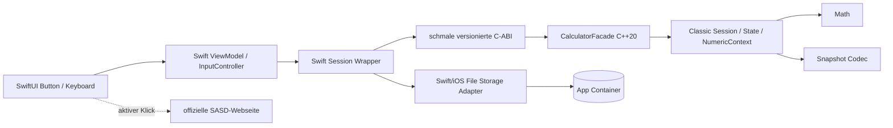

# ADR-V1-API – Schnittstelle C++20 ↔ Swift/iOS und iPhone-XS-Kompatibilität

**ADR-ID:** ADR-V1-API (mit iOS-Kompatibilitätsprüfung)  
**Datum:** 2026-11-21  
**Status:** **PROPOSED / NICHT FREIGEGEBEN**  
**Fällig:** vor nativer iPhone-Integration und öffentlicher C-/Swift-Schnittstelle (WP-06 / M2)  
**Anforderungen:** `LH-ARCH-001/006/010/011`, `LH-UI-001…011`, `LH-NF-004/009/012`, `LH-OD-005/006/007`  
**Grundlagen:** [Architektur](../ARCHITEKTUR.md), [Pflichtenheft](../PFLICHTENHEFT.md), [Classic-Input-ADR](ADR-V1-INPUT.md), [State-ADR](ADR-V1-STATE.md), [V1-Test-/Freigabeplan](../de/V1-TEST-UND-FREIGABEPLAN.md)

> **Vorgabe:** C++20-Domänenlogik und SwiftUI-Oberfläche sind entkoppelt. **V1 braucht eine native offline nutzbare iPhone-App mit dem iPhone XS als Testziel.** Das heute vorhandene Repository enthält noch keine native iOS-App. Die hier gezeigten ABI-Funktionen sind **Pseudoprototypen**, keine implementierte oder bereits bindende API.

## 1. Kontext und Systemgrenze



**Verbindliche Abhängigkeitsrichtung:** UI → Swift-Adapter → ABI → Domain. Kein Calculator-C++-Modul importiert SwiftUI, Foundation, Objective-C oder Netzwerk-APIs. Der SwiftUI-Key-Handler enthält **keine eigene Arithmetik** und keinen zweiten `LAST X`-/Stackalgorithmus. Die mathematischen Operationen werden nie über eine HTTP-API oder dauerhaft laufenden Webserver ausgeführt.

## 2. Architekturentscheidungsalternativen

| Alternative | Vorteile | Nachteile | Empfehlung |
| --- | --- | --- | --- |
| A: direkte C++-Interop aus Swift | weniger C-Boilerplate | stärkere Compiler-/C++-ABI-Kopplung, sehr sorgfältige Ownership-/Exceptionprüfung | für Spike zulässig |
| B: explizite, **versionierte C-ABI** und Swift-Wrapper | klarer Stabilitäts-/Fehler-/Speichervertrag, weitere Plattformen nutzbar | schmale zusätzliche Schicht | **empfohlen** |
| C: reine Swift-Neuimplementierung des Kerns | direkte SwiftUI-Anbindung | Duplikate, Widerspruch zur portablen C++-Entscheidung | für Scientific Core **nicht empfohlen** |
| D: HTTP/Webservice-Engine | unabhängige Bereitstellung | offline-/App-Sandbox- und Betriebskosten, unnötig | **verworfen** |

Die Wahl B ist **nicht** bereits durch einen existierenden Header bewiesen. Ein kleiner realer C++-Bridge-/SwiftUI-Spike auf der ausgewählten Xcode-Version ist vor dem API-Freeze nötig.

## 3. ABI-Vertrag: Regeln, Versionspolitik und Ownership

### 3.1 Prinzipien

- **C-kompatible FFI-Grenze:** `extern "C"`, feste Integergrößen (z. B. `uint32_t`), Längen als `size_t` mit expliziter Validierung, opaque Session-Handle, keine STL-/Swift-/Objective-C-Objekte in der öffentlichen ABI.
- **Fehlertransport:** stabile `sc_status`-Codes. **Keine** C++-Exception darf die C-ABI verlassen; alle internen Exceptions werden sicher in Diagnose übersetzt oder abgefangen.
- **Keine eingebauten C-Strings ohne Länge** für untrusted Nutzdaten; expliziter UTF-8-/Byte-Buffervertrag. Eingabe-UTF-8 vor Interpretation prüfen.
- **Output:** bevorzugt zweistufige Abfrage `required_size` / Buffer-Copy. Bei zu kleinem Buffer wird der erforderliche Wert angegeben und keine Teil-Domain-Daten geliefert.
- **Speicherverwaltung:** einziges definiertes Paar `create/destroy`; Swift-Wrapper hält den Handle und beendet ihn genau einmal; keine langlebigen Borrowed Pointers in Swift.
- **Threading:** Domänensession wird von **einer serialisierten Command-Queue / einem klaren Actor-Eigentümer** mutiert. ViewState erhält eine Generation und wird als Konsistenz-Snapshot kopiert.
- **Version:** `ABI_MAJOR.MINOR`, Major-Bump bei inkompatibler C-Grenze, Erweiterungen über neue Funktionen/Felder/Command-Fähigkeiten; keine stille enum-Reihenfolgenänderung.
- **Capability-Listing:** zeigt **tatsächlich implementierte** Commands, nicht historische Katalogwünsche.
- **Keine Dateisystemabhängigkeit:** Domain/Codec erzeugen/lesen Buffers; Swift/iOS kümmert sich um App-Container, Dateischutz und atomare Ablage.
- **Keine C-Callbacks in V1 erforderlich:** minimale synchronisierte, kleine Commands. Lange historische Programme erhalten später ausdrücklich spezifizierte Abbruch-/Async-Ports.

### 3.2 Illustratives C-Header-Skelett – **nicht implementiert**

Die folgenden Namen/Typen sind eine **zu überprüfende Schnittstellenskizze**, kein fertiger Drop-in-Header. Pointer-/Length-/Error-Konventionen werden im technischen Bridge-Spike mit C++, Swift und Sanitizern geprüft.

```c
/* ILLUSTRATIVE ONLY — not an approved public header. */
#pragma once
#include <stddef.h>
#include <stdint.h>

#ifdef __cplusplus
extern "C" {
#endif

typedef struct sc_session sc_session;

typedef enum sc_status {
    SC_OK = 0,
    SC_BUFFER_TOO_SMALL = 1,
    SC_INVALID_ARGUMENT = 2,
    SC_INVALID_HANDLE = 3,
    SC_UNSUPPORTED_COMMAND = 4,
    SC_CALCULATION_ERROR = 5,
    SC_INCOMPATIBLE_STATE = 6,
    SC_RESOURCE_LIMIT = 7,
    SC_INTERNAL_ERROR = 8
} sc_status;

/* Stable numeric version, e.g. (major << 16) | minor. */
uint32_t sc_abi_version(void);

/* On failure, *out_session is null. profile is a bounded UTF-8 byte sequence. */
sc_status sc_session_create(const uint8_t *profile,
                            size_t profile_len,
                            sc_session **out_session);

/* Destroy is called exactly once for a valid owned handle. */
void sc_session_destroy(sc_session *session);

/* Payload encoding is itself separately specified/versioned. */
sc_status sc_session_execute(sc_session *session, uint32_t command_id,
                             const uint8_t *payload, size_t payload_len);

/* Two-phase read: out_buf may be null if capacity=0; return required bytes. */
sc_status sc_session_read_view(sc_session *session,
                               uint8_t *out_buf, size_t capacity,
                               size_t *required_size);

/* Same buffer contract; output is a validated versioned snapshot blob. */
sc_status sc_session_encode_snapshot(sc_session *session,
                                     uint8_t *out_buf, size_t capacity,
                                     size_t *required_size);

/* Never changes the live session on validation failure. */
sc_status sc_session_restore_snapshot(sc_session *session,
                                      const uint8_t *data, size_t size);

#ifdef __cplusplus
}
#endif
```

**Zu ergänzen vor Freigabe:** genaue Command-/Payload-Schema-ID, Fehlerdetailabruf ohne Race, atomare „Buffergröße + Generation“-Sicht, `destroy(NULL)`-/Double-Destroy-Regeln, begrenzte Buffer-Größen, Session-Kontextwechsel und Quelltext-Dokumentation. **Nicht** unbewusst C-ABI-Fehlercodes mit historischen HP-Fehlernummern gleichsetzen.

### 3.3 Swift-Wrapper

**Vorgeschlagene Konvention:**

- `@MainActor`-ViewModel nimmt UI-Taps entgegen und serialisiert Domain-Commands. Es hält ein gekapseltes Swift-Objekt mit **einem** C-Session-Handle.
- Der Wrapper übersetzt C-Statuscodes in typisierte Swift-Diagnosen und lokale DE/EN-Texte; keine Formatierung im C-Math-Core durch UI.
- `CalculatorViewState` wird **als Momentaufnahme** kopiert und aus dem fachlichen Zustand abgeleitet; Swift darf ihn rendern, aber **nicht** unabhängig berechnen.
- `deinit` oder expliziter `close` sorgt für `destroy`. Swift-Concurrency/`Sendable`-Regeln, Ownership und MainActor-/Background-IO-Ausführungswege werden per Spike bestätigt.
- Nach `execute` wird **nur** eine neue Generation angezeigt; lange Zeichenketten werden als UTF-8-Länge geprüft und Fehler per Code behandelt.
- Save-/Restore-Dateivorgänge erfolgen über den iOS-Storage-Port nach [ADR-V1-STATE](ADR-V1-STATE.md), nicht aus C++-Dateipfaden heraus.

## 4. API-Fehler, Abbruch, Längen und Sessionsicherheit

| Problem | Vertrag |
| --- | --- |
| Null-/invalides Handle | `SC_INVALID_HANDLE`, kein Crash; exakte Double-Destroy-Policy festlegen |
| Ungültige Payload/UTF-8/Command-ID | definierter `INVALID_ARGUMENT` oder `UNSUPPORTED_COMMAND`, State unverändert |
| Zu kleiner Output-Buffer | `SC_BUFFER_TOO_SMALL` + required size; kein Out-of-bounds |
| Decoder-/Numerikfehler | typisierte Diagnose/Code, kein Host-C++-Exception-Leak |
| Fehler bei Snapshot-Restore | Live-Session bleibt gültig und unverändert |
| Gleichzeitige `execute`-/`encode`-Aufrufe | durch Eigentümer serialisiert; keine undokumentierte Reentranz |
| A/B-Versionen inkompatibel | Major-/Schema-Check; nicht einfach falsch reinterpretieren |
| Zerstörte Session erneut verwendet | Swift-Wrapper verhindert; native API darf keinen falschen Sicherheitsanspruch erheben, solange Pointer-Validity nicht prüfbar ist |
| UI-Thread blockiert | für kurzzeitige Operationen messen; längere Jobs später eigener abbruchfähiger Worker |

**Sicherheitskritisch:** Ein roher Pointer auf bereits freigegebenen Speicher lässt sich nicht stets zuverlässig auf „invalid handle“ prüfen. Die API muss dies über **eingekapselten Ownership-Vertrag** verhindern oder ein echtes Handle-/Generation-Registry-Verfahren definieren. Keine Schutzgarantie durch bloßes Pointer-Vergleichen erfinden.

## 5. Geräte- und SDK-Kompatibilität – iPhone XS

### 5.1 Offiziell überprüfte Ausgangsfakten (Stand 2026-11-21)

- **Apple Security Releases** nennt für **iPhone XS / XS Max / XR** die **iOS-18.7.12-Linie** vom **09.11.2026**. Die neuere iOS-26-Sicherheitslinie wird für **iPhone 11 und neuer** angegeben; das XS gehört **nicht** zur iOS-26-Gerätelinie.  
  Quelle: https://support.apple.com/en-us/100100
- Apples **Xcode System Requirements** führen **Xcode 27.2** (macOS Tahoe 26.6+, iOS-27.2-SDK) auf und erlauben als **iOS Deployment Target** Versionen **15–27**; die **Device Support**-Spalte lautet **iOS 17 or later**. Somit ist ein iOS-18-Ziel grundsätzlich innerhalb der aufgelisteten Bereiche. **Ob das Projekt mit konkreten verwendeten SwiftUI-/SDK-APIs auf dem realen iPhone XS funktioniert, ist damit noch nicht getestet.**  
  Quelle: https://developer.apple.com/xcode/system-requirements/
- Apples **App Store Connect Upload-Vorgaben** verlangen laut aktueller Apple-Seite **Xcode 26 oder neuer mit SDK für iOS 26 oder neuer**. Der *SDK-Buildstand* ist von dem für Nutzergeräte vorgesehenen *Deployment Target* zu unterscheiden.  
  Quelle: https://developer.apple.com/news/upcoming-requirements/

**Technische Empfehlung, noch zu beschließen:** `IPHONEOS_DEPLOYMENT_TARGET = 18.0` als realistischer Kandidat für XS-Unterstützung **unter aktuellem Xcode/SDK**. Keine API einsetzen, die erst iOS 26/27 voraussetzt, ohne getesteten Fallback oder Availability-Guard. Die konkrete Xcode-Buildnummer und Testergebnisse gehören in einen reproducierbaren iPhone-XS-Report.

### 5.2 iOS-Kompatibilitätsmatrix vor M2-Freigabe

| Prüfpunkt | Mindestnachweis | Status |
| --- | --- | --- |
| SDK-/Xcode-/macOS-Version | `xcodebuild -version`, `xcrun --sdk iphoneos --show-sdk-version`, Zielruntime | **noch auszuführen** |
| iOS Deployment Target | bewusst gewählte Version ≤ tatsächliches iPhone-XS-iOS, Target in Xcode-Projekt geprüft | **offen** |
| Kompilieren/Linken `arm64` | native C++20-/C-ABI-/SwiftUI-App für reale iOS-Geräte | **nicht vorhanden** |
| Reales XS-Gerät | OS-/Hardwareversion, Install, Launch, Touch, Calculation, Restore, Offline | **nicht getestet** |
| Simulator (ergänzend) | passende iOS-Runtime und Gerätetyp soweit verfügbar | **kein Ersatz** für reales XS |
| SwiftUI-API-Verfügbarkeit | API Availability und Accessibility für iOS-18-Ziel | **offen** |
| AppStore Connect | aktueller Xcode/SDK-/Signing-/Privacy-/Listing-Check | **nicht beantragt** |
| Frontend Architektur | Rechner füllt Portrait ohne verdeckte Tasten, Dynamic Type/VoiceOver | **geplant** |
| Backend Offline | keine Netzwerkpflicht, Werbe-/Abo-/Tracking-SDKs | **geplant und zu prüfen** |
| Branding | kleines klickbares `SASD` oben links, echte offizielle URL | URL **noch zu bestätigen** |

**Keine falsche Schlussfolgerung:** „SDK 27“ bedeutet **nicht**, dass die App nur auf iOS 27 laufen muss. Umgekehrt beweist der iOS-18-Deployment-Target-Eintrag **nicht**, dass aktuelle SwiftUI-APIs oder Simulator-/Gerätefeatures ohne Fallback funktionieren.

## 6. iPhone-UX- und Accessibility-Vertrag

- V1-iPhone-Hochformat zeigt Display, klassische RPN-Tastatur und Status; **keine permanenten Desktoppaneele, kein erzwungenes `=`.
- Alle freigegebenen Befehle einschließlich Shift-/ALPHA-/Menü-Kontext sind erreichbar, auch auf XS mit Safe Areas.
- Zielbereich für Touchlabels, Dynamic Type, Zoom-/Layout-Brüche, VoiceOver-Ansagen und aktivem Fehlerstatus wird am realen Gerät abgenommen.
- SwiftUI bietet barrierefreie Labels für z. B. „Enter“, „Stack X und Y tauschen“, „Gradmodus“, „Register 00 speichern“; Shift-/Statusinformationen können sinnvoll angekündigt werden.
- Die Anzeige ermittelt numerische Werte **nicht** aus Strings, sondern aus konsistenten `ViewState`-Daten.
- Der SASD-Link öffnet nur nach Nutzeraktion einen externen Browser. Berechnung/Offlinehilfe bleiben ohne Internet funktionsfähig.

## 7. Build-, Paket- und Teststrategie

- Portable Engine weiterhin über `CMake/CTest` auf Linux/Windows/macOS.
- Native iOS-Targets mit freigegebenen Apple-Tools, Compilerflags, eingebundener C++-Bibliothek, linker-/visibility-korrekter C-ABI, ohne neue erzwungene Runtime-Abhängigkeiten.
- Verifikation der C-Grenze in eigenem C-only-Compile-/Link-Smoke und Swift-Wrapper-Integration.
- Address/Undefined-Behavior-Sanitizer wo von Target/Toolchain unterstützt; bei realem iPhone-XS-Target praktische Grenzen dokumentieren.
- Für jede ABI-Änderung: Major/Minor-Bewertung, Buffer-Längen-/Ownership-Tests, Swift-Consumer und CLI-Regression.
- iOS-Release-Gate nur durch reale App-/Gerätetests; Linux-/Mac-C++-Build allein reicht nicht.

### 7.1 Geplante ABI-Testfälle

| ID | Test | Erwartung |
| --- | --- | --- |
| ABI-001 | C-Header aus C und C++ kompilieren | keine C++-Typen in C-Schnittstelle |
| ABI-002 | Erstellen, Ausführen, Lesen, Zerstören | kein Ressourcenleck / klarer Lifetime |
| ABI-003 | Null-/invalides Payload, ungültiger Command | Fehler ohne State-Verlust |
| ABI-004 | erforderliche Outputgröße, zu kleiner Buffer | kein OOB, erforderliche Länge ausgegeben |
| ABI-005 | UTF-8 fehlerhaft und sehr große Länge | kontrollierter Fehler/Resource-Limit |
| ABI-006 | C++-Ausnahme innerhalb eines Wrapper-Calls | kein Exception-Übergang nach Swift/C |
| ABI-007 | Thread-affinity/Parallelaufrufe | serialisiert/definiert rejected, keine Races |
| ABI-008 | zwei Sessions, verschiedene Registerwerte | kein gegenseitiger State-Einfluss |
| ABI-009 | Snapshot Encode/Restore bei defektem Payload | validierter Rollback |
| ABI-010 | Buffer-Sicht `ViewState`-Generation | keine halb alten/halb neuen Werte |
| IOS-XS-001 | echter iPhone-XS-Install/Start | alle erforderlichen UI-Funktionen verfügbar |
| IOS-XS-002 | Flugmodus; RPN rechnen und Offlinehilfe | ohne Netzwerk funktionsfähig |
| IOS-XS-003 | Background/Terminate/Restore | keine beschädigte Session |
| IOS-XS-004 | Dynamic Type/VoiceOver/Screen-Safe-Areas | kein abgeschnittener/überlagerter Bedienbereich |
| IOS-XS-005 | iOS-18-Availability-Test | keine ungeschützte spätere API |

## 8. Entscheidungsgates

- [ ] C-ABI vs. direkter Swift/C++-Interop-Ansatz nach realem Spike entschieden.
- [ ] ABI-Typen/Version/Ownership/Threading/Fehler und Payload-Codec akzeptiert.
- [ ] tatsächliche iPhone-XS-iOS-Version und Toolchain-/macOS-Version protokolliert.
- [ ] Deployment Target, API-Verfügbarkeit und App-Store-Uploadregeln nach aktuellem Apple-Stand bestätigt.
- [ ] Xcode-Build, reales Install/Run und ABI-/UX-/Restore-/Offline-Tests durchgeführt.
- [ ] SASD-Web-URL, deutsche/englische Hilfe, Privacy/Signing/Store-Listing verbindlich.
- [ ] Nur bei belegtem Ergebnis im Entscheidungsregister `ACCEPTED` setzen.

**Nachfolgende Mac-/Windows-/Linux-Frontends:** benötigen nicht SwiftUI; sie verwenden die gleiche fachliche Command-Fassade und eigene Plattformadapter. Die moderne ALG-App und die historische RPL-App können **getrennt** veröffentlicht werden. Financial ist ein anderes Repository.
