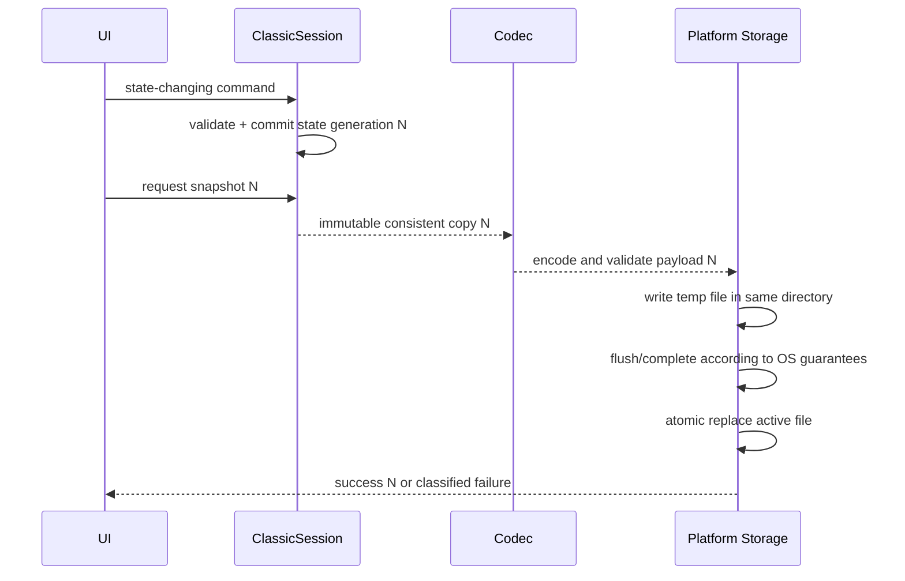

# ADR-V1-STATE – dauerhafter Rechnerzustand, Snapshot, Migration und Wiederherstellung

**ADR-ID:** ADR-V1-STATE  
**Datum:** 2026-11-21  
**Status:** **PROPOSED / NICHT FREIGEGEBEN**  
**Fällig:** vor der ersten persistierenden Classic-RPN-Implementierung (WP-05 / M1–M2)  
**Lastenheft:** `LH-DATA-001…009`, `LH-RPN-001…011`, `LH-NF-002/003`, `LH-OD-004`  
**Grundlagen:** [Pflichtenheft](../PFLICHTENHEFT.md), [Gesamtarchitektur](../ARCHITEKTUR.md), [Numerik-ADR](ADR-V1-NUM.md), [Input-ADR](ADR-V1-INPUT.md), [V1-Abnahme](../de/V1-TEST-UND-FREIGABEPLAN.md)

> **Ziel:** Eine korrekt laufende, offline nutzbare Rechner-Session darf nach App-Hintergrundwechsel, regulärem Neustart oder einem unterstützten Upgrade nicht überraschend verloren gehen. **Das Datenformat ist bisher nicht beschlossen**. Diese ADR liefert einen konkreten Entwurf und eine vollständige Liste von Ausfall-, Migrations- und Validierungsregeln.

## 1. Datenklassen – strikt unterscheiden

| Typ | Inhalt | Ziel/Owner | V1-MUSS? |
| --- | --- | --- | --- |
| **CalculatorSnapshot** | X/Y/Z/T, LAST X, Eingabepuffer, Register, Lift-/Entry-Status, Angle-/Display- und NumericPolicy | C++-Domäne definiert Daten; Codec serialisiert; iOS speichert | **ja** |
| **AppPreferences** | lokalisierten Text, UX-Einstellungen, Accessibility-Präferenzen, ggf. Skin | SwiftUI/iOS-Adapter; kein numerisches Interpretationsrecht | nur für tatsächlich vorhandene Optionen |
| **History/Undo** | vorherige Aktionen/Zustände, wenn im Funktionsfreeze freigegeben | eigener optionaler Speicherabschnitt | **nicht automatisch** V1-Pflicht |
| **ProgramFile41** | Rohbytes historischer FOCAL-/Synthetic-Programme | 41er-Codec und virtueller Programmspeicher | **später M3/M4** |
| **RPLObjectFile48** | historische 48er-Objekte/Nibbles/Programme | 48er-Codec | **später M3/M4** |
| **Rom/ModuleProfile** | Modell, ROM-Version, virtuelle Ressourcen, Modul-Capabilities | historische VM-Profile | **später**, nicht Original-ROM kopieren |
| **Help/Learning** | Offline-Dokumentation, optional Lernfortschritt | UI-Hilfe/Training | kurze Offlinehilfe ja; Lernfortschritt später |

**Keine** rohe `memcpy`-Speicherung von C++-Objektlayouts, std::vector-/Pointer-Werten, nativen Endianess-abhängigen Bitfeldern oder Foundation/SwiftUI-Zuständen als Domain-Wahrheit.

## 2. Anforderungen und Invarianten

- **STATE-INV-01:** Jede gespeicherte Datei benennt `schema_version` und `calculator_model_id`.
- **STATE-INV-02:** NumericPolicy und Interpretation reeller Werte sind Teil des Schemas; ein Modellwechsel darf Werte nicht still konvertieren.
- **STATE-INV-03:** Eingabepuffer und Rechenwerte bleiben logisch getrennt; `1.2E-` darf nicht als gültige Zahl in X gespeichert werden.
- **STATE-INV-04:** Restore ist **transaktional**: alle Felder geprüft, bevor eine bestehende gültige Session ersetzt wird.
- **STATE-INV-05:** Ein neuerer vollständiger State darf nicht von einem **älteren verspäteten Hintergrund-Save** überschrieben werden.
- **STATE-INV-06:** Beschädigte/unbekannte Daten lösen Diagnose/Recovery aus, keine Abstürze, keine behauptete erfolgreiche Wiederherstellung.
- **STATE-INV-07:** Die Persistenz hat einen vom UI getrennten Codec-Port; Dateipfade gehören in den Plattformadapter.
- **STATE-INV-08:** Historische 41er-Rohbytes/48er-Objekte werden später **verlustfrei und versioniert** speicherbar, ohne V1 binary64 zum universellen Format zu erklären.
- **STATE-INV-09:** Ein einfacher Checksum-Wert beweist nur erkannte Beschädigung, **keine** kryptografische Authentizität.
- **STATE-INV-10:** Ein App-Prozessabbruch unmittelbar vor dem ersten erfolgreichen Save kann nicht garantieren, dass die allerletzte Tastenaktion persistent ist. Zusagen und Testkriterium müssen zwischen bestätigtem/angefordertem Save unterscheiden.

## 3. Alternativen

| Ansatz | Plus | Minus | Entwurfsbewertung |
| --- | --- | --- | --- |
| A: UIKit/SwiftUI-SceneState allein | einfach | keine stabile fachliche Modell-/Migration-/Port-Garantie | **nicht ausreichend** |
| B: versioniertes JSON mit Zahlencodierung als Text | gut les-/auditierbar, C++/Swift möglich, V1 klein | Parser/Größen/Locale sicher handhaben, große Historikobjekte ungeeignet | **empfohlen für modernen Classic-V1-Start** |
| C: CBOR/protobuf/eigener Binärcodec | kompakt, typisiert | Schema-/Tooling-/Dependencyaufwand | zulässig nach ADR, später historisch womöglich sinnvoll |
| D: roher C++-Memory-Dump | kurzfristig einfach | nicht portabel/sicher/versionierbar | **verworfen** |
| E: ausschließlich Cloud-/Account-Speicherung | mehrere Geräte | Netz- und Datenschutzzwang | **für V1 ausgeschlossen** |

**Empfehlung:** B für den **kleinen V1-Classic-Snapshot**, mit gesondertem persistenzneutralem Domain-State und nachvollziehbarem Textwert-Codec. Die Wahl des korrekten JSON-Parsers/Serializers unter C++20/iOS wird im technischen Spike geprüft; ein neues großes Framework ist nicht nötig.

## 4. Vorgeschlagene Versionierung und Formatstruktur

**Beispielpayload zur Illustration – kein final freigegebenes Schema und keine bereits vorhandene Datei:**

```json
{
  "format": "sasd.scientific.classic.snapshot",
  "schema_version": 1,
  "calculator_model": "classic-rpn-modern",
  "numeric_policy": "REAL_BINARY64_V1",
  "state_generation": 42,
  "data": {
    "stack": {
      "x": "23",
      "y": "0",
      "z": "0",
      "t": "0"
    },
    "last_x": "20",
    "registers": {
      "00": "3.5",
      "01": "7"
    },
    "entry": {
      "active": false,
      "mantissa": "",
      "exponent": "",
      "exponent_active": false,
      "lift_enabled": true
    },
    "modes": {
      "angle": "DEG",
      "display": "SCI",
      "display_digits": 8
    }
  }
}
```

Die Beispielzahlen/Modi/Registernummern sind **nur Beispiele** und dürfen nicht als beschlossene V1-Registerzahl, Genauigkeit oder historischer HP-41C-Stackeffekt gelesen werden. **Checksum/Length** können als versionierter Envelope außerhalb des JSON-Payloads liegen; wenn innerhalb, definiert der ADR eindeutig über **welche Bytes** die Prüfung läuft. Eine Hash-Prüfung über einen JSON-String ohne kanonische Encoding-/Sortierdefinition ist **nicht robust**.

### 4.1 Zahlencodierung

- Wenn NumericPolicy **binary64** wird: vorgeschlagene Dezimal-Strings mit gesichertem **round-trip** für alle zugelassenen endlichen Werte (beispielsweise `std::numeric_limits<double>::max_digits10` oder äquivalente, geprüfte Kodierung); `-0`-Erhalt nach Numeric-ADR entscheiden.
- Umgekehrtes Parsing muss Locale-unabhängig (kanonischer Punkt) und gegen Exponent-/Überlauf-/Unendlichkeiten validiert sein.
- **Display-Text** (FIX/SCI/ENG, lokalisierte Kommas) ist **kein** Speicherersatz für den originalen numerischen Wert.
- Für späteres 41er-Register: sieben Rohbytes statt einem nummerischen Anzeige-String; für 48er RPL: Nibble-/Objektnutzlast mit Prolog/Größe/virtueller Adresse je historischer Profil-ADR.

### 4.2 Versionieren statt implizit raten

- Unbekannte **major/schema**-Version → nicht in die aktive Session laden; prüfbare „zu neu“-/„nicht unterstützt“-Diagnose.
- Gleiche Version mit unbekannter optionaler Erweiterung → **nur** nach definiertem Extension-Vertrag ignorieren.
- Alte unterstützte Version → Validierung **vor**, Migration **nach** eindeutig spezifizierten Schritten; kein verkürzter „Try-Parse“-Pfad, der Fehlfelder als 0 annimmt.
- Exportiertes Snapshotformat ist nicht gleich künftigen historischen Programmaustauschformaten.
- Name, Schema, Build und App-Version dienen reproduzierbaren Datentests. Ein Git-Commit muss **nicht** zwingend Teil des Nutzersnapshots sein, sollte aber im Release-/Testprotokoll verfügbar sein.

## 5. Save-Protokoll (transaktional)



**Entwurfsregel:** Ein single-writer/Serial-Queue-/Generation-Gate verhindert, dass Snapshot N−1 später N überschreibt. Zu jedem bestätigten Save gibt es eine **exakt benannte Generation**. Speicherauslösung nach jeder Eingabe oder Entprellung, Hintergrund-Events und OS-Lifecycle dürfen später optimiert werden, solange das zugesagte Verlustfenster tatsächlich gemessen und dokumentiert ist.

**Atomic Replace ist kein Magiewort:** Auf Apple-Systemen müssen die konkreten FileManager-/POSIX-Operationen, Backup-Optionen, iCloud-/Dateischutzwirkungen und Crash-/Power-Loss-Garantien **praktisch** geprüft werden. Nicht jedes rename/replace garantiert dieselbe Haltbarkeit. Eine zweite gültige Generation (Backup oder zwei Slots) ist für Recovery zu prüfen.

## 6. Restore-Protokoll (validieren vor Commit)

1. Lesbare aktive Datei? Falls nein: leere neue Session mit **sichtbar erkennbarem** Initialzustand; wenn beschädigte Datei existiert, nicht kommentarlos löschen.
2. Dateigrößen-/Envelope-Limits vor speicherintensivem Parse prüfen.
3. Formatkennung, Version, Payload-Länge/Checksum und Encoding validieren.
4. CalculatorModel/NumericPolicy/Profilcapabilities müssen unterstützt sein; fehlende Kompatibilität melden.
5. X/Y/Z/T/LAST X/Registeranzahl/Index/Wert-Parse, erlaubte numerische Domains, Entry- und Modus-Invarianten vollständig prüfen.
6. Falls zulässige ältere Version: **nach dokumentierten Regeln** migrieren, anschließend erneut validieren.
7. Fertige **temporäre Session** erzeugen und erst dann per atomarer Sessionübergabe aktiv machen.
8. Bei Fehlschlag: unveränderte vorhandene Session oder definierten sicheren Initialzustand behalten, ggf. letzte gültige Backupgeneration laden **mit dokumentierter Nutzerinformation**.
9. Datei nicht „reparieren“, indem ungültige Zahlen still auf 0 gerundet oder falsche Register abgeschnitten werden.

### 6.1 Negativfälle

| Fehler | Sicheres Verhalten |
| --- | --- |
| Snapshot endet in halbem UTF-8/JSON-Token | Parsefehler, keine State-Teilmutation |
| `numeric_policy` unbekannt | `UNSUPPORTED_NUMERIC_POLICY` |
| `X` ist `NaN`/`Infinity` oder nicht parsebar | `INVALID_VALUE`, kein undefiniertes Register |
| fehlende LAST-X-/Entryfelder | nur bei definierter Migration zulässig |
| negative Registeradresse, doppelte unerlaubte Felder | Schemafehler |
| aktive Entry-Daten unvereinbar mit X/lift_state | Fehler oder **explizit** definierte Recovery |
| „zu neue“ Schema-Version | nicht als alte Version laden |
| korrupte primäre Datei, intakte Backupgeneration | Backup nur nach Prüfroutine, Recovery sichtbar |
| Speicherzugriff verweigert oder Festplatte voll | alten gültigen Snapshot erhalten |
| neue Generation wird vor älterem Async-Save gespeichert | ältere Generation wird verworfen |

## 7. Sicherung und tatsächliche App-Lebenszyklen

Zu testen: App im Vordergrund; Hintergrundwechsel; OS-Suspend; Force Quit; anschließend regulärer Relaunch; Gerät mit begrenztem Speicher; Update zwischen Schema-Versionen; App-Absturz während Tempfile-/Rename-Stufe; paralleler Save.

**Klarstellung zu Neuinstallation:** Ein Deinstallieren der iOS-App entfernt üblicherweise ihre lokalen App-Container-Daten. Dieses Projekt **verspricht nicht**, dass Daten nach Deinstallation ohne gültiges Backup oder expliziten Export automatisch wieder vorhanden sind. Das Lastenheft verlangt zuverlässige Wiederherstellung bei normalen App-Lebenszyklen und unterstützten Upgrades; darüber hinausgehende Backup-/Exportziele müssen separat entschieden werden.

## 8. Sicherheits- und Größengrenzen

- Vor dem Deserialisieren: maximale Dateilänge/JSON-Tiefe/Anzahl Registers/Zeichenketten definieren und mit Edge-Cases testen.
- Keine Ausführung eingebetteter Befehle oder beliebiger Host-Dateipfade aus einer Snapshot-Datei.
- Keine Übernahme von Objektpointern, Dateideskriptoren, Thread-/UI-Handles, nativen C++-Layouts.
- Datei-Checksum kann Korruption erkennen, **nicht** absichtliche Manipulation verhindern. Für spätere Untrusted Programmdaten sind zusätzliche Interpreter-/Host-Grenzen nötig.
- Sensitive Daten sind für einen typischen Rechner gering, aber iOS-Sandbox-/Datenschutzregeln und Backups bleiben zu beachten.

## 9. Abnahmetests

| Test-ID | Versuch | Erwartung |
| --- | --- | --- |
| STATE-001 | Standardzustand → Encode → Decode | alle relevanten Felder identisch |
| STATE-002 | jede vierte Stackebene + LAST X + Register unterschiedlich | keine Daten-/Reihenfolgeverwechslung |
| STATE-003 | aktive Mantisse/Exponent-Eingabe | exakt nach beschlossener Entry-Recovery |
| STATE-004 | FIX/SCI und DEG/RAD umstellen, Save/Restore | Modus und numerischer Wert getrennt erhalten |
| STATE-005 | Größe/Truncation/ungültiges JSON | kein Crash/Partial Commit |
| STATE-006 | unbekannte Version oder NumericPolicy | definierte inkompatibel-Diagnose |
| STATE-007 | altes unterstütztes Schema | deterministische Migration mit Testfixture |
| STATE-008 | Quelle ist neuere Generation, älterer Save kommt später | aktiver Snapshot bleibt bei neuer Generation |
| STATE-009 | Fehler vor/nach Write/Replace | gültiger Altstand bleibt erreichbar |
| STATE-010 | Backupgeneration korrekt / korrupt | nur verifizierte Generation wird geladen |
| STATE-011 | `max_digits10` Roundtrip | binary64-Werte bitgleich, nach Numeric-ADR |
| STATE-012 | iPhone XS Hintergrund/Neustart/Upgrade | reale reproduzierbare Restoreprüfung |
| STATE-013 | vollgelaufener Speicher/keine Schreibberechtigung | kontrollierter Fehler und gültige alte Datei |
| STATE-014 | zwei Sessions/Modelle nacheinander | keine Profil-/Register-/Snapshotverwechslung |
| STATE-015 | manipuliertes `state_generation`/Payload-Länge | sichere Erkennung; keine Sicherheitslücke |

## 10. Entscheidungsvorlage / abzusegnende Festlegungen

- [ ] Format (JSON/CBOR/Binär), NumericPolicy-/Model-ID und konkrete Schemanummer.
- [ ] Roundtripkodierung und `-0`-Behandlung.
- [ ] Umfang der Register und persistierenden Entry-/Shift-/Undo-Zustände.
- [ ] Integritäts-/Längenprüfung, Limits und Recovery-Backupstrategie.
- [ ] Speicher-Scheduler: bei jedem Tap/debounce/Lifecycle und tatsächlich zugesagtes Verlustfenster.
- [ ] Dateipfad/Backup-/Datenschutzklassifikation auf iOS; Atomic-Replace-Verfahren mit Gerätetest.
- [ ] Migration alter/zu neuer Schemas, Recovery-UX und Testfixtures.
- [ ] Datums-/Beleg-/Entscheidungsvermerk in [DECISIONS.md](../en/DECISIONS.md).

**Kein V1-Blocker:** Historischer FOCAL-/Synthetic-Bytecode, RPL-Objektcodec, Strict-Historical-RAM-Dateien und plattformübergreifender Programmexport. Deren spätere Datenmodelle müssen nur **nicht durch dieses V1-Format unmöglich gemacht** werden.
